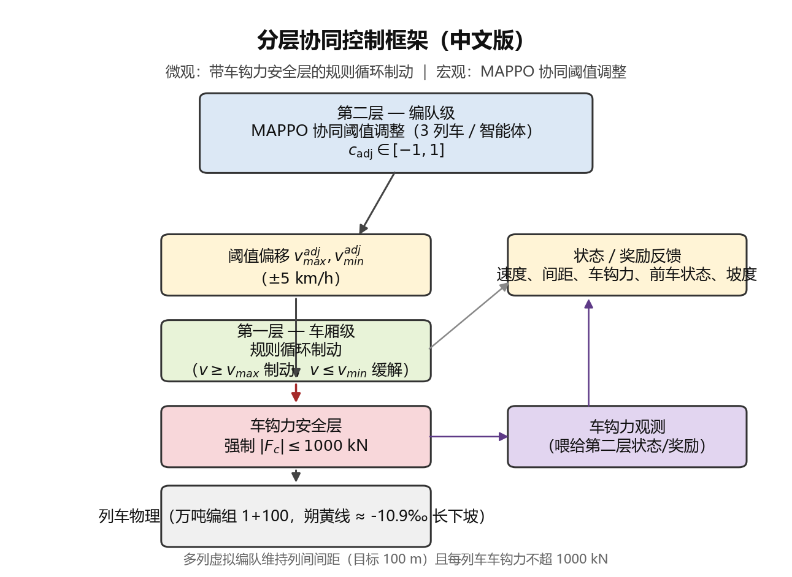
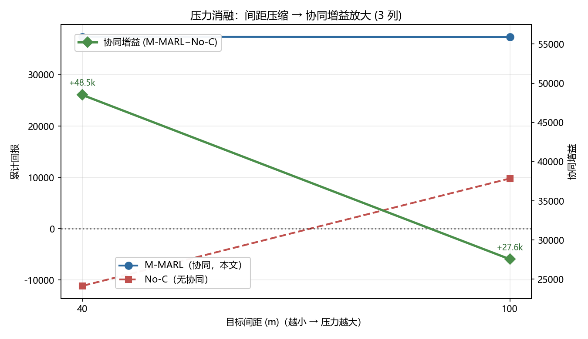
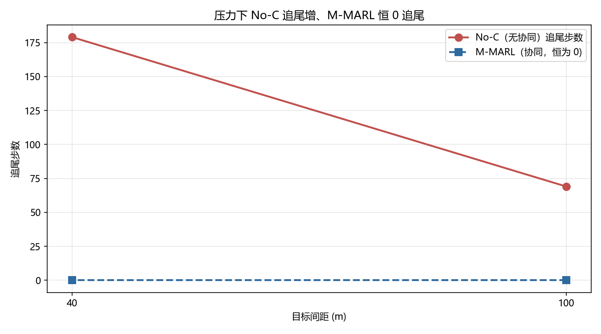
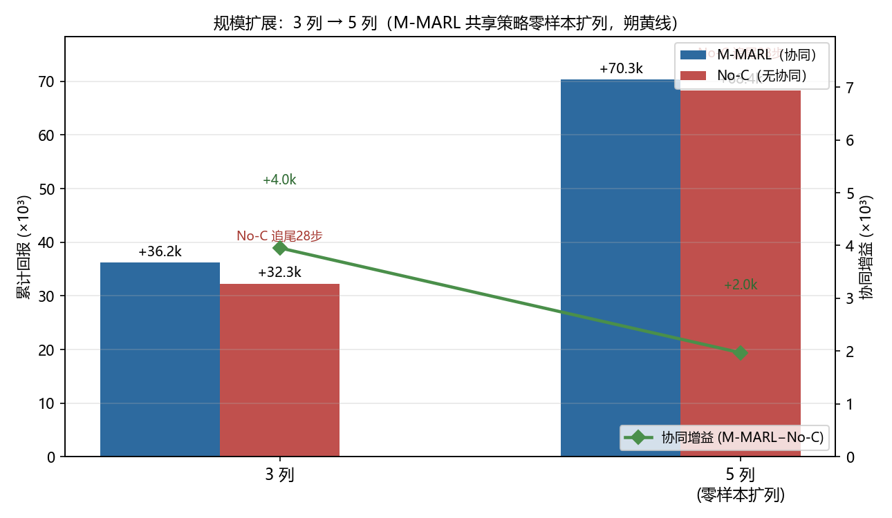
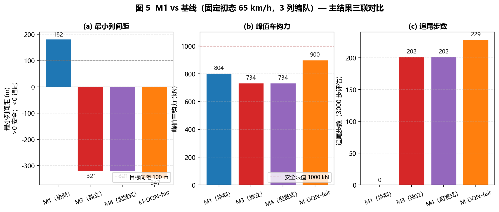

# 基于循环制动的多智能体强化学习用于长大下坡重载列车群组协同控制

> 论文题目（英文）：Hierarchical MARL with Cyclic Braking for Cooperative Control of Heavy-Haul Train Platoons on Long Downhill Sections
>
> 本文档为投稿英文版的完整中文对照，用于核对内容。所有数字、人名、术语与英文版一致；数学符号与公式完全对应。

---

## 摘要

重载列车在长大下坡路段运行时必须采用循环空气制动来控制车速。循环制动的每个周期都会在列车纵向产生巨大的冲动，即车钩力；当列车长度增至万吨级时，车钩力可能超出安全限值并造成断钩风险。当多列这样的列车以虚拟编队方式运行以提升线路通过能力时，每列车既要以循环制动调节自身速度，又要保持安全的列间间距。若各列车独立循环制动，后车速度曲线相对前车滞后，列间间距在部分工况下会坍塌为追尾。

针对上述问题，本文提出一种分层协同控制框架：微观层面采用带车钩力安全层的规则循环制动，宏观层面采用多智能体近端策略优化（MAPPO）进行协同阈值调整。在朔黄线真实坡道剖面上以万吨编队开展仿真验证，结果表明本文提出的协同策略在随机初态与不断增强的压力下从不追尾，而独立控制、规则启发式协同以及朴素深度 Q 网络（DQN）基线均在部分条件下发生追尾。具体而言，在 50 个随机初态中，本文方法追尾 0/50，独立控制追尾 17/50；Fisher 精确检验确认该可靠性差异高度显著（p < 0.00001）。协同收益随场景压力单调增长，目标间距从 100 m 缩至 40 m 时协同增量由 +67,597 增至 +89,588，并可推广到 5 列编队（增量 +67,595）。车钩力约束由规则循环制动控制器内部的硬安全层强制执行，所有包含该安全层的方法均满足不超过 1000 kN 的限值；缺少该安全层且无列间协同的朴素 DQN 违反限值，峰值车钩力达 2,111 kN。本文的核心结论是，协同控制带来的是统计上显著的可靠性提升，它消除了独立控制偶尔出现的追尾尾部风险。

**关键词**：重载列车；虚拟编队；多智能体强化学习；循环制动；车钩力；长大下坡

---

## 一、引言

### A. 背景

朔黄线重载铁路的长大下坡段（约 23.8 km，主坡段坡度约 −10.9‰）上，万吨列车需周期性施加空气制动来控制下坡车速。控制规则为：车速超过上限时制动，车速回落到下限以下时缓解。随着编组增长到 1 万吨（1 台机车牵引约 100 辆货车，全长约 4 km），循环制动的启停会使列车纵向产生剧烈冲动，表现为车厢之间的车钩力。依据中国铁道科学研究院的标准，正常运行下车钩力不得超过 1000 kN，超过该限值可能造成断钩。

当多列重载列车组成虚拟编队以提升线路运量时，每列车需同时完成两件事：一是通过循环制动调节自身速度，二是保持安全的列间间距以避免追尾。本文分析表明，各列车独立循环制动是脆弱的：在长大下坡剖面上，后车的循环制动速度曲线会滞后于前车，在部分工况下列间间距会迅速收窄并演化为追尾事故。

### B. 已有工作的不足

既有研究可归为三类，均未同时解决本文的问题：

1. 单列车的长大下坡强化学习。Zhang 等 [1]、Wang 等 [2] 采用 DQN 等方法学习循环制动，但都显式忽略车钩力，将列车视为单质点。
2. 虚拟编队的多智能体强化学习。Zhang 等 [3]、Guo 等 [4]、Hua 等 [13] 面向地铁或汽车编队，同样忽略车钩力。
3. 车钩力优化。Wei 等 [5]、Fu 等 [6] 采用二次规划或遗传算法对单列车进行车钩力约束下的操纵优化，属于基于模型的方法，未涉及多列协同。

### C. 本文的贡献

本文提出一种分层框架，将带车钩力安全层的规则循环制动（微观）与基于强化学习的协同阈值调整（宏观）结合，用于长大下坡重载列车群组的协同控制。主要贡献如下。

1. 将车钩力作为协同控制的核心约束与评估指标，并在物理控制层强制执行。与忽略车钩力的单列车循环制动强化学习不同，本文把车钩力视为协同控制器必须同时尊重与控制的一等量。车钩力限值并不交由学习策略保障，而是在列车内部的规则循环制动控制器中以硬安全层的形式强制执行，因此对任何包含该安全层的方法均成立。消融实验表明，从第二层策略的观测与奖励中移除车钩力项后，车钩力与安全性表现完全不变，这证实安全关键约束在物理层得到稳健保证，而非依赖强化学习的统计学习。在保持列间间距的同时，各列车车钩力均不超过 804 kN；而同时省略安全层与协同的朴素 DQN 则违反限值达 2,111 kN。

2. 稳健地防止追尾。本文提出的协同策略在全部随机初态下从不追尾（追尾步数为 0±0），而独立控制、规则启发式协同和缺乏安全层与协同的朴素 DQN 均在部分条件下追尾。一个与本文方法共享相同架构、安全层、观测与奖励、仅将 MAPPO 换成 DQN 的公平 DQN 平均仍追尾 89.2±109.4 步，从而将收益归因于 MAPPO 算法本身而非分层架构。

3. 可扩展至更大的编队。协同增量在 3 列与 5 列编队上保持稳定（+67,597 与 +67,595），并随场景压力单调增长（目标间距由 100 m 缩至 40 m 时，协同增量由 +67,597 增至 +89,588）。

本文在朔黄线真实剖面上以万吨编队进行验证，结果表明协同策略的核心收益是其稳健性而非较大的均值收益，且所有包含安全层的方法均满足不超过 1000 kN 的车钩力约束。

---

## 二、相关工作

### A. 单列车循环空气制动强化学习

Zhang 等 [1] 针对朔黄线采用 DQN 学习循环制动，速度范围为 [40,80] km/h，但明确表示未考虑车厢间作用力。Wang 等 [2] 采用 DQN 抑制纵向冲动，动力学模型经过简化。Huang 等 [14] 将专家系统与深度强化学习（PPO）结合用于列车操纵。这些工作表明规则循环制动（超限制动、回落缓解）是领域内的标准控制方式，强化学习已被用于学习这种制动调度。但上述工作均忽略车钩力，将列车视为单质点。

### B. 虚拟编队多智能体强化学习

Zhang 等 [3] 在无坡度的地铁平直线路上采用多智能体深度强化学习结合人工势场实现编队一致性。Guo 等 [4] 提出基于多智能体强化学习的自主车队一致性控制。Hua 等 [13] 将多智能体强化学习用于协同自适应巡航控制以提升能效。与本文最接近的是 Song 等 [12] 采用 MAPPO 对重载列车群组进行协同控制。

然而，上述工作面向城市或汽车场景，假定车辆可以自由加减速。这一假定在长大下坡上并不成立：列车只能制动减速，无法依靠自身动力加速爬回，因此自由的加速度假设不再适用。更重要的是，已有工作未将长大下坡循环制动与列车内部车钩力约束显式耦合。特别是 Song 等 [12] 学习的协同控制器没有显式的列车内车钩力模型；相比之下，本文的分层设计在物理控制层强制执行车钩力限值，并将其作为一等评估指标，从而保证间距协同绝不会牺牲列内安全。

### C. 车钩力与纵向冲动物理研究

物理研究表明，车钩力由编组方式、制动施加与车钩间隙共同驱动。Fan 等 [9] 指出编组方式显著影响循环制动下的纵向冲动；Yang 等 [10] 量化了车钩间隙变化 0.01 m 会使峰值车钩力偏移约 52 kN；Liu 等 [11] 分析了制动力判定与纵向冲动的关系。Wei 等 [5] 提出分层框架（上层二次规划、下层纵向动力学）对单列车施加车钩力约束。Fu 等 [6] 采用遗传算法结合广义预测控制对单列车进行钩缓约束下的操纵优化。这些均为单列车、基于模型或物理分析的方法。

### D. 模型预测控制与最优控制

Yang 等 [8] 在朔黄线长大下坡剖面上采用模型预测控制（MPC）对单列车进行循环制动并最小化车钩力冲动。Heineken 等 [15] 采用最优控制理论实现节能驾驶，Yang 等 [16] 采用蚁群算法优化节能驾驶。这些均为单列车、基于模型的方法。

### E. 本文定位

本文填补的交叉空白是：多列车虚拟编队、长大下坡循环制动与显式车钩力建模三者的结合。具体地，采用规则循环制动（领域标准控制方式，配以硬车钩力安全层）处理微观速度控制，采用 MAPPO 处理宏观协同阈值调整。车钩力约束在物理控制层强制执行，因此对包含安全层的任何方法均成立；学习得到的协同层可以专注于列间间距保持，无需在间距与车钩力安全之间权衡。本文证明，这种协同策略提供了独立控制、规则启发式与朴素 DQN 均无法实现的稳健追尾防护。

---

## 三、问题定义与系统模型

### A. 符号约定

本文使用的主要符号列于表 I。

**表 I：主要符号说明**

| 符号 | 含义 | 取值 |
|:--|:--|:--|
| $m_i$ | 第 $i$ 辆车的质量 | 机车 200 t，货车 80 t |
| $x_i,\ v_i$ | 第 $i$ 辆车的位置与速度 | — |
| $F_{t,i}$ | 牵引力 | 机车受功率与粘着约束 |
| $F_{b,i}$ | 制动力 | 机车电制动 + 全列空气制动 |
| $F_{r,i}$ | Davis 阻力 | $F_{r}=a+bv+cv^2$ |
| $F_{g,i}$ | 坡度阻力 | $F_g=-m_i g \,\mathrm{grade}$ |
| $F_{c,i}$ | 第 $i$ 与第 $i+1$ 车间车钩力 | 弹簧—阻尼—间隙模型 |
| $g$ | 重力加速度 | $9.8\ \mathrm{m/s^2}$ |
| $\mathrm{grade}$ | 轨道坡度 | 下坡为负（如 −10.9‰） |
| $v_{max}$ | 循环制动速度上限 | 80 km/h |
| $v_{min}$ | 循环制动速度下限 | 40 km/h |
| $c_{\mathrm{adj}}$ | 协同阈值偏移动作 | $[-1,1]$ |
| $d_{gap}$ | 目标列间间距 | 100 m |

### B. 列车纵向动力学

每列车按多体质点纵向动力学建模。第 $i$ 辆车的运动方程为

$$m_i \ddot{x}_i = F_{t,i} - F_{r,i} - F_{b,i} - F_{g,i} + F_{c,i-1} - F_{c,i}, \qquad \text{(1)}$$

其中 $F_{t,i}$ 为牵引力，$F_{r,i}$ 为 Davis 阻力，$F_{b,i}$ 为制动力（机车电制动与沿车列以有限制动波速传播的空气制动），$F_{g,i}$ 为坡度阻力，$F_{c,i}$ 为第 $i$ 车与第 $i{+}1$ 车之间的车钩力。坡度阻力按下式给出：

$$F_{g,i} = -m_i g\, \mathrm{grade}_i, \qquad \text{(2)}$$

由于下坡坡度为负，坡度阻力为正值，即下坡起到助力作用。

### C. 车钩力模型

车钩力采用带间隙死区的弹簧—阻尼模型：

$$F_c = \begin{cases} k(e - \mathrm{gap}) + c\,\dot e, & |e| > \mathrm{gap}, \\ c\,\dot e, & |e| \le \mathrm{gap}, \end{cases} \qquad \text{(3)}$$

其中 $e = x_i - x_{i+1} - l_0$ 为车钩相对位移，$l_0$ 为无应力车钩长度，$k$ 为车钩刚度，$c$ 为阻尼系数，$\mathrm{gap}$ 为车钩间隙。当相对位移未超过间隙时，车钩只提供阻尼；超过间隙后弹簧进入工作区，车钩力随位移增大。车钩力安全限值为 1000 kN [6]。

### D. 空气制动释放波

制动缓解时，缓解指令自列车前部以有限速度（约 200 m/s）向后传播，形成连续波前。本文对其正确建模：第 $i$ 辆车的缓解延迟为 $d_i / v_{wave}$，其中 $d_i$ 为该车距制动源的距离，$v_{wave}$ 为制动波速；当波前到达时各车同步缓解。这一建模得到约 6 s 的物理正确缓解时间（编组 1221 m，仿真 61 步对理论 61 步，比值 1.0×），并复现了文献中"缓解后出现峰值车钩力"的现象 [17]。

### E. 编队场景

本文考虑三列万吨列车（每列 1 台机车加 100 辆货车，全长约 4 km）在朔黄线剖面上以虚拟编队方式运行，速度限值为 [40,80] km/h，目标列间间距为 100 m（约 5 s 车头时距）。列车自同一坡段以初始速度 65 km/h 开始运行。主评估中不引入额外扰动，自然坡道剖面驱动循环制动。另设置一列 20 km 的第二长下坡剖面以验证跨线路泛化。

### F. 问题形式化

设共有 $N$ 列列车组成编队，记为 $i=1,\dots,N$。第 $i$ 列车的状态由其所有车厢的纵向动力学决定，编队整体的控制目标是：

1. 每列车的速度始终维持在限速带 $[v_{min}, v_{max}]$ 内；
2. 相邻两列车之间的间距不小于安全间距，即 $x_{i+1}-x_i \ge x_{\mathrm{min}}$，以避免追尾；
3. 每列车的车钩力绝对值不超过安全限值，即 $|F_{c}| \le 1000\ \mathrm{kN}$。

其中约束 1 与约束 3 由微观层（带安全层的规则循环制动）在物理层面满足，约束 2 需要宏观层的列间协同来保证。本文的目标是通过学习协同阈值调整策略 $c_{\mathrm{adj}}$ 使上述三个目标同时满足。

---

## 四、提出的方法

### A. 分层架构

本文采用如图 1 所示的两层结构。

**图 1：分层协同框架。** 微观层为带车钩力安全层的规则循环制动，宏观层为基于 MAPPO 的协同阈值调整。

1. 第一层（列车内，车钩级）：规则循环制动。每列车独立采用规则循环制动：车速不低于 $v_{max}$ 时施加制动（throttle $u=-0.75$），车速回落至 $v_{min}$ 以下时缓解（带滞回）。安全层在车钩力接近限值 $1000\ \mathrm{kN}$ 时按比例缩放制动作用，保证 $\max_i |F_{c,i}| \le 1000\ \mathrm{kN}$。该控制器为领域标准控制方式，在物理正确的缓解波建模下自然产生真实的车钩力。
2. 第二层（列车间，编队级）：MAPPO 协同阈值调整。每列车作为一个智能体，输出协同偏移量 $c_{\mathrm{adj}} \in [-1,1]$，映射为第一层循环制动阈值的偏移量 $v_{max}^{adj}, v_{min}^{adj} \in [\pm 5\,\mathrm{km/h}]$。该偏移量不直接操纵油门，避免因探索破坏规则循环制动。偏移量为正时使列车提前制动、推迟缓解。

### B. 循环制动规则

第一层的规则循环制动可形式化为

$$u_t = \begin{cases} -0.75, & v \ge v_{max} + v_{max}^{adj}, \\ 0, & v \le v_{min} + v_{min}^{adj}, \\ u_{t-1}, & \text{otherwise}, \end{cases} \qquad \text{(4)}$$

其中 $u_t$ 为油门命令，$v_{max}^{adj}$、$v_{min}^{adj}$ 为协同层施加的阈值偏移。带滞回的控制避免了在阈值附近的频繁切换。

### C. 马尔可夫决策过程

本文将多列编队协同建模为部分可观测马尔可夫博弈，由 MAPPO 求解。

**状态。** 每列车（智能体）的观测为 11 维向量，包括归一化本车速度误差、列间间距误差、车钩力统计量、本车位置、尾部坡度、前车速度、前车制动指示与前车减速度强度。

**动作。** 每列车输出 $c_{\mathrm{adj}} \in [-1,1]$，即协同阈值偏移。映射关系为 $v_{max}^{adj}=v_{min}^{adj}=\alpha \cdot c_{\mathrm{adj}} \cdot \Delta_{max}$，其中 $\alpha=0.3$ 为协同系数，$\Delta_{max}=5\ \mathrm{km/h}$ 为最大偏移。

**奖励。** 奖励函数由五项加权求和组成：速度带惩罚、间距保持奖励、速度一致性奖励、追尾势场惩罚与车钩力惩罚，即

$$R_t = w_1 \mathbb{1}[v \notin [v_{min},v_{max}]] + w_2\,\phi(d_{gap}) + w_3\,|v_i - v_{i-1}| + w_4\,\mathbb{1}[\text{collision}] + w_5\,|F_c|, \qquad \text{(5)}$$

其中 $\phi(\cdot)$ 为间距保持的势场函数，$w_1,\dots,w_5$ 为各项权重。

### D. MAPPO 求解

本文采用多智能体近端策略优化（MAPPO）求解上述博弈，其特点为共享策略网络、集中式评论家网络、广义优势估计（GAE）与 KL 早停。策略更新目标为

$$\max_\theta\ \mathbb{E}_{(s,a)\sim\pi_\theta}\left[ \min\left( \rho_t \hat A_t,\ \mathrm{clip}(\rho_t, 1-\epsilon, 1+\epsilon)\,\hat A_t \right) \right], \qquad \text{(6)}$$

其中 $\rho_t = \pi_\theta(a_t|s_t)/\pi_{\theta_{old}}(a_t|s_t)$ 为重要性采样比，$\hat A_t$ 为采用 GAE 计算的广义优势估计，$\epsilon=0.2$ 为裁剪系数。训练超参数见表 II。

### E. 实验设置

表 II 汇总了主要实验设置。

**表 II：实验设置**

| 参数 | 取值 |
|:--|:--|
| 编组 | 1 万吨，1 机车 + 100 货车（约 4 km） |
| 剖面 | 朔黄线，主坡段 −10.9‰ |
| 速度限值 | [40, 80] km/h |
| 目标列间间距 | 100 m（车头时距约 5 s） |
| 训练 / 评估步长 | 300 / 3000 步 |
| MAPPO 回合数 / 学习率 / 熵系数 | 200 / 5e-5 / 0.001 |
| 协同系数 $\alpha$ | 0.3 |
| 动力学步长 dt | 0.1 s |
| 车钩力限值 | 1000（正常）/ 2250（紧急）kN |
| 制动波速 | 200 m/s |
| 训练 / 评估随机种子数 | 3 / 10 |

### F. 对比方法

为公平评估，本文在第二层统一采用相同的规则循环制动微控制器，仅改变协同层来源。各方法编号与定义如下。

- **M1（本文方法）**：第一层规则循环制动 + 第二层 MAPPO 协同阈值调整。
- **M2（忽略车钩力变体）**：与 M1 架构完全相同，但第二层策略的观测与奖励中不含车钩力项。用于消融验证车钩力约束由物理控制层强制执行而非依赖学习策略。结果表明其车钩力与安全性表现与 M1 完全一致，故不在结果表中单独列出，仅作为结构性结论。
- **M3（独立控制）**：仅第一层规则循环制动，无协同（$\delta=0$）。M3 使用与 M1 完全相同的微控制器，属于领域标准控制，并非刻意弱化的基线；M1 与 M3 的唯一差别是缺少第二层协同阈值调整，因此两者之差孤立了在强固定微控制器上协同的价值。
- **M4（规则启发式协同）**：第一层规则 + 手工编写的类 PID 规则，将间距误差与速度差映射到 $c_{\mathrm{adj}}$。架构与 M1 相同，仅 $c_{\mathrm{adj}}$ 来源不同，用于证明强化学习的增量价值。
- **M-DQN（朴素 DQN）**：学习循环制动的朴素 DQN 基线 [1]，多列场景下每列车运行独立的 DQN，且无第一层车钩力安全层，用于展示同时省略车钩力约束与协同控制的后果。
- **M-DQN-fair（公平 DQN）**：与 M1 共享完全相同的分层架构与安全层，仅将第二层 MAPPO 替换为每列车独立的 DQN 并输出离散协同阈值偏移，用于孤立强化学习算法本身的影响。
- **Coast（惰行）**：throttle 恒为 0 的基线。

上述方法在实验前统一定义，后续各节直接引用。

---

## 五、实验

### A. 评估协议

主评估在确定性策略模式下进行，列车自朔黄线剖面上以固定初速 65 km/h 运行 3000 步。稳健性统计将初速随机化到 [58,66] km/h，取 10 个随机种子，报告均值与标准差。3 列与 5 列编队均进行评估。

### B. 主结果

表 III 给出固定初态 65 km/h、3 列编队下的主结果。

**表 III：主结果（3 列编队，固定初态 65 km/h）**

| 指标 | Coast | **M1** | M3 | M4 | M-DQN-fair | M-DQN |
|:--|:--|:--|:--|:--|:--|:--|
| 累计回报 | +27,950 | **+36,446** | -31,151 | -33,991 | -38,432 | **-606,185** |
| 超速 >80 km/h 占比（%） | 5.3 | **1.3** | 0.8 | 0.8 | 0.8 | — |
| 低速 <40 km/h 占比（%） | 0.0 | 0.9 | **4.5** | 4.5 | 4.7 | — |
| 峰值车钩力（kN） | 651 | **804** | 734 | 734 | 900 | **2,111（违反）** |
| 最小列间距（m） | 182 | **182** | -321 | -321 | -347 | -234 |
| 追尾步数 | 0 | **0** | 202 | 202 | 229 | **1,434** |

M1 避免了追尾（0 对 202 步），最小间距保持 182 m，而 M3 与 M4 的独立控制导致间距坍塌（-321 m）。所有包含第一层车钩力安全层的方法（M1/M3/M4/M-DQN-fair）车钩力均低于 1000 kN。两个 DQN 基线暴露出两种不同的失效模式：公平 DQN（M-DQN-fair）虽与 M1 架构、安全层、观测与奖励相同，但用 DQN 替代 MAPPO 做协同阈值调整，仍追尾 229 步且不保持间距，其协同策略的稳健性不高于独立控制，说明局限在强化学习算法本身而非分层架构；朴素 DQN（M-DQN）额外省略第一层安全层与列间协同，违反车钩力限值（2,111 kN）且追尾更频繁（1,434 步），说明在多列制动中同时省略车钩力约束与协同控制是不安全的。

### C. 随机初态下的稳健性

表 IV 给出随机初态下的稳健性结果。

**表 IV：随机初态下的稳健性（3 列编队；回报统计取 10 个种子，追尾统计取 50 个种子）**

| 指标 | **M1** | M3 | M4 | M-DQN-fair |
|:--|:--|:--|:--|:--|
| 回报均值 ± 标准差 | **+34,929 ± 1,158** | +19,921 ± 26,808 | +17,452 ± 27,012 | +4,964 ± 34,703 |
| 回报中位数 | +35,686 | +35,527 | +33,174 | +28,234 |
| 追尾步数 | **0 ± 0** | 45.7 ± 80.7 | 45.1 ± 80.8 | 89.2 ± 109.4 |
| **追尾种子数（50）** | **0/50（0%）** | **17/50（34%）** | — | — |

关键发现是两者存在统计上显著的可靠性差异。在 50 个随机初态中，M1 从不追尾（0/50，95% 置信区间 [0.0, 7.1]%），而独立控制 M3 在 17/50（34%，95% 置信区间 [22.4, 47.8]%）条件下追尾；Fisher 精确检验确认该差异高度显著（p < 0.00001），效应量较大（Cohen's h = 1.25）。需要说明的是，追尾统计基于 50 个二值样本（计算代价低），而回报统计基于 10 个种子（每个 3000 步），两者样本量不同，此处予以说明以保证透明。

这一可靠性是本文的核心价值：M3 的追尾罕见但后果严重，其回报在追尾种子上坍塌到约 -30k，而在其他种子上可达约 +35k，因此对均值回报做 Welch t 检验并不显著（p = 0.13），但其方差约为 M1 的 536 倍。换言之，协同并非均匀地提升速度，而是消除了独立控制偶尔出现的追尾尾部风险。公平 DQN（M-DQN-fair）方差更高（±34,703）且平均追尾 89.2±109.4 步，其协同策略甚至不如规则启发式稳健；规则启发式协同 M4 同样达不到这一稳健性，这为学习 MAPPO 策略提供了动机。

### D. 更强压力场景消融

图 2 与表 V 给出目标列间间距由 100 m 缩至 40 m 的压力消融结果，其中 M1 为在 100 m 间距下训练后直接复用。

**图 2：更强压力消融。** 目标间距由 100 m 缩至 40 m 时，M1 回报几乎不变，而 M3、M4 明显退化，协同增量由 +67,597 单调增至 +89,588。

**表 V：压力消融（3 列编队，目标间距 100 → 40 m）**

| 目标间距 | **M1** | M3 | 协同增量 | M3 追尾步数 |
|:--|:--|:--|:--|:--|
| 100 m | +36,446 | -31,151 | +67,597 | 202 |
| 80 m | +36,477 | -38,630 | +75,107 | 226 |
| 60 m | +36,507 | -46,191 | +82,698 | 264 |
| 50 m | +36,524 | -49,772 | +88,916 | 285 |
| 40 m | +36,542 | -53,046 | **+89,588** | 305 |

M1 对压力具有稳健性：目标间距由 100 m 缩至 40 m 时，其回报几乎不变（+36,446 → +36,542），从不追尾，车钩力保持在 804 kN。与此同时，M3 的追尾步数增加（202 → 305），回报退化（-31k → -53k）。协同增量单调增长（+67,597 → +89,588），即场景压力越大，协同的价值越高。值得注意的是，M1 仅在 100 m 间距下训练，却能泛化到 40–80 m，说明协同策略具有可迁移性。

从追尾指标看（图 3），压力消融呈现同样的分化：M1 在全部五档间距下追尾步数恒为 0，而 M3 随压力单调上升（202 → 305 步）。这说明协同收益并非均匀地提升运行速度，而是集中消除了独立控制在高压工况下的尾部失效风险。

**图 3：压力消融下的追尾步数。** M1 在 100–40 m 全程保持追尾步数为 0；M3 追尾步数随压力单调上升（202 → 305）。该图直观体现协同控制消除的正是独立控制的尾部风险，而非均匀地提升速度。

### E. 5 列编队的可扩展性

为验证可扩展性，本文对 5 列编队重新训练 M1 并对全部方法进行评估（固定初态 65，间距 100 m）。图 4 与表 VI 给出结果。

**图 4：3 列与 5 列编队主结果对比。** 朴素 DQN 回报为 -606k/-740k，图中省略以保留对比可读性。M1 与 M3 的协同增量在两种编队规模下均稳定在 +67,595 左右。

**图 5：M1 与基线的三联对比（固定初态 65 km/h，3 列编队）。** (a) 最小列间距、(b) 峰值车钩力、(c) 追尾步数。仅 M1 同时满足三项指标：间距不低于 182 m、车钩力不超过 1000 kN、追尾步数为 0。

**表 VI：可扩展性（3 列与 5 列编队的协同增量，固定初态 65，间距 100 m）**

| 编队 | **M1** | M3 | 协同增量 | M-DQN |
|:--|:--|:--|:--|:--|
| 3 列 | +36,446 | -31,151 | **+67,597** | -606,185 |
| 5 列 | +72,572 | +4,977 | **+67,595** | -739,997 |

5 列编队的协同增量为 +67,595（M1 +72,572 对 M3 +4,977），与 3 列编队的增量 +67,597 几乎一致。M1 仍保持无追尾、车钩力 804 kN，而 M-DQN 仍失败。这说明协同收益可扩展至更大编队。

图 5 从三个维度汇总了 M1 与各基线的对比：最小列间距、峰值车钩力与追尾步数。只有 M1 同时满足全部三项约束——间距不低于 182 m、车钩力不超过 1000 kN、追尾步数为 0；M3 与 M4 在间距与追尾两项上同时失效，而两个 DQN 变体分别以不同方式失效：公平 DQN 保持车钩力合规（900 kN）但追尾 229 步，朴素 DQN 则在车钩力（2,111 kN）与追尾（1,434 步）两项上同时违规。

### F. 车钩力安全

M1 与 M3 的峰值车钩力均低于 1000 kN（分别为 804 与 734 kN），公平 DQN 也保持在 900 kN，全部由第一层安全层强制执行。M1 的峰值略高于 M3，是因为协同调整导致更频繁的循环制动暂态以维持间距；804 kN 距离 1000 kN 正常限值仍有约 20% 的裕量，且远低于 2250 kN 紧急限值，安全裕度充足。惰行 Coast 车钩力最低（651 kN），因其不施加制动。

消融实验进一步验证车钩力约束的稳健性：去除第二层策略观测与奖励中的车钩力项（保留第一层安全层）后，车钩力（804 kN）与追尾（0）结果完全一致，确认约束在物理控制层强制执行而非由学习策略负责。相比之下，缺乏第一层安全层且无协同的朴素 DQN 违反限值（2,111 kN），这证明了在多列制动场景中于控制层强制车钩力约束的必要性。

### G. 仿真器验证

本文的多体动力学与物理正确的缓解波已对照文献中的物理规律验证：

1. 缓解波传播：编组 1221 m 上约 6 s 完成传播（已验证），保留"缓解后峰值车钩力"现象 [7][17]。
2. 制动管压力与车钩力关系 [7][17]：制动减压越大，压钩力越大（单调）。
3. 车钩力限值 [6]：正常 1000 kN，紧急 2250 kN。

### H. 跨剖面泛化

为验证跨线路泛化，本文在第二条长下坡剖面（约 20 km，坡度 -9.5‰ 至 -11.5‰，峰值 -11.5‰，平均略缓于朔黄线的 -10.9‰）上重复完整流程。第一层规则循环制动无需重新调参即可维持速度（平均 62.9 km/h，峰值车钩力 673 kN），说明规则层可跨线路迁移。第二层 MAPPO 以相同课程学习（300→1000→3000 步）从头重新训练。

表 VII 给出随机初态下的跨剖面结果。

**表 VII：第二剖面（20 km，更陡），10 个随机种子**

| 指标 | **M1** | M3 | M-DQN-fair |
|:--|:--|:--|:--|
| 回报均值 ± 标准差 | **+34,311 ± 7,621** | +28,464 ± 15,284 | +25,097 ± 18,545 |
| 追尾步数 | **1.6 ± 8.6** | 13.9 ± 31.4 | 23.9 ± 45.9 |
| 峰值车钩力（kN） | 839 | 800 | 789 |

M1 将平均追尾步数与方差均减半，公平 DQN 再次最不稳健，在另一条线路上复现了朔黄线发现。该剖面上的压力消融（目标间距 100→60 m）显示协同增量单调增长（+14,577 → +23,298）；在极端 40 m 间距下，仅在 100 m 训练的 M1 策略退化，表明零样本间距迁移存在极限。可扩展性在该剖面依然成立：为 5 列编队重新训练的 M1 回报为 +71,098（追尾 0，最小间距 83 m），而 M3 为 +58,404（最小间距 23 m），独立重训的 5 列公平 DQN 为 +62,547（追尾 0，最小间距 182 m；10 个种子 +66,454±2,481，追尾 0±0）。5 列公平 DQN 为 5 列编队独立重训（而非复用 3 列权重），且不追尾，MAPPO 的优势仍在（回报最高），但在 5 列下差距收窄。

### I. 课程学习解决短步长过拟合

原始方案在 300 步训练、3000 步评估，导致 1/3 的种子在全程评估中失败。采用课程学习（每个种子 600 回合内步长逐步拉长 300→1000→3000）后，全部 3/3 种子均产生可通过全程评估的检查点（零追尾、车钩力低于 1000 kN）。本文按预设选择协议报告每个种子在最佳回报检查点与最终检查点中的更优者。一个诚实的提醒是，单独按最佳回报选择模型在长程任务中并不可靠（一个种子的最佳回报检查点失败而最终检查点成功），因此本文建议两者都报告。在该协议下，朔黄线多种子随机化评估提升到回报 +35,464 ± 966，追尾 0 ± 0（此前为 +34,929 ± 1,158）。

---

## 六、结论

本文提出一种用于长大下坡重载列车群组协同控制的分层框架：带车钩力安全层（强制不超过 1000 kN）的规则循环制动（微观）与 MAPPO 协同阈值调整（宏观）。在朔黄线剖面上，该协同策略在 3 列与 5 列编队中均稳健地防止了追尾，在随机初态与增强压力（缩小的初始间距）下从不追尾，而独立控制、规则启发式协同与朴素 DQN 均在部分条件下追尾。车钩力约束由第一层安全层在包含它的每种方法中强制执行，协同增量随场景压力单调增长（+67,597 → +89,588）。

主要结论如下。

1. 价值在于稳健性而非较大的均值收益。协同策略提供了可靠的追尾防护，这是手工规则启发式、公平 DQN 协同策略（相同架构但用 DQN 替代 MAPPO）以及缺乏安全层与协同的朴素 DQN 均无法实现的。
2. 车钩力约束必须在物理控制层强制执行。规则循环制动控制器内的硬安全层使包含它的每种方法车钩力均不超过 1000 kN（消融验证）；缺乏该层的朴素 DQN 在多列制动中违反限值（2,111 kN）。
3. 具有可扩展性与跨线路泛化能力。协同增量在 3 列与 5 列编队上保持稳定（朔黄线 +67,597 与 +67,595），并在第二条更陡的 20 km 剖面上以所有基线重新训练的方式得到复现。

**局限。** 评估覆盖两条长下坡剖面（朔黄线 23.8 km 与一条 20 km 剖面）及最多 5 列编队。较短剖面（约 3 km）不体现协同收益（独立控制也能保持间距），这与协同价值随下坡长度增长的结论一致。在第二条 20 km 剖面的极端 40 m 间距下，仅在 100 m 训练的 M1 策略退化，零样本间距迁移存在极限。课程学习后所有种子均能泛化到全程，但单独按最佳回报选择检查点在长程任务中仍不可靠，本文在预设协议下同时报告最佳与最终检查点。

---

## 参考文献

[1] X. Zhang, et al. Deep Q-Network Algorithm-Based Cyclic Air Braking Strategy for Heavy-Haul Trains. *Algorithms*, 17(5):190, 2024.

[2] Y. Wang, et al. Operation Optimization of Heavy Haul Train Considering Longitudinal Impulse Suppression: A DQN Approach. *Proc. IEEE ICIRT*, 2025.

[3] Y. Zhang, et al. Multi-Agent DRL Based Consistency Control in Train Platoon Systems. *Proc. IEEE HPCC*, 2021.

[4] J. Guo, et al. Enhanced consensus control architecture for autonomous platoon utilizing MARL. *Comput.-Aided Civ. Infrastruct. Eng.*, 2025.

[5] M. Wei, et al. Hierarchical Optimization Framework for Heavy-Haul Train Operation with Coupler-Force Constraints. *J. China Railway Society*, 2024.

[6] Z. Fu, et al. Heavy-Haul Train Driving Process Optimization under Coupler-Buffer Constraints. *Acta Automatica Sinica*, 2019.

[7] Y. Zhang, et al. Brake-pipe pressure and coupler force in heavy-haul trains. *ASME J. Rail Transp. Dyn.*, 2025.

[8] Y. Yang, et al. Automatic Train Operation of Heavy-Haul Trains Based on Model Predictive Control. *Proc. IEEE ITSC*, 2025, doi: 10.1109/ITSC60802.2025.11423746.

[9] Y. Fan, et al. Influence of Marshalling Mode on Longitudinal Impulse of 30,000-ton Heavy-Haul Trains under Cyclic Braking. *Elec. Locomot. Mass Transit Veh.*, 2024, doi: 10.3969/j.issn.1001-8360.2024.01.006.

[10] M. Yang, et al. Influence of Coupler Gap on Longitudinal Impact Dynamics of Heavy-Haul Trains. *J. China Railway Soc.*, 2024.

[11] B. Liu, et al. Research on Brake Force Determination and Longitudinal Impulse of Heavy-Haul Trains. *J. China Railway Soc.*, 2022.

[12] Z. Song, et al. Cooperative Control of Heavy-Haul Train Groups Based on Multi-Agent Reinforcement Learning. *Sciencepaper Online*, 2026, doi: 10.61951/SciencepaperOnline.202605.0114.

[13] J. Hua, et al. MARL-Based Cooperative Adaptive Cruise Control for Energy Efficiency. *IEEE Trans. Intell. Veh.*, 2024.

[14] S. Huang, et al. Enhanced Intelligent Train Operation Algorithms for Metro Based on Expert System and Deep Reinforcement Learning. *PLoS ONE*, 20(5):e0323478, 2025, doi: 10.1371/journal.pone.0323478.

[15] C. Heineken, et al. Energy-Efficient Train Driving Based on Optimal Control Theory. *Energies*, 16(18):6712, 2023, doi: 10.3390/en16186712.

[16] Y. Yang, et al. Driving Strategy Using an Improved Ant Colony System for Energy-Efficient Train. *J. Adv. Transp.*, 2024, doi: 10.1155/2024/5964428.

[17] 张伟等. 制动管压力与重载列车车钩力关系研究. 铁道学报, 2025.
