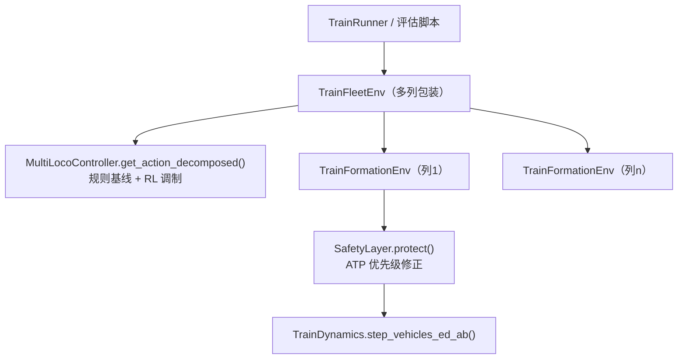

# 编队训练环境与安全层 Knowledge Base

## §0 Contents

| § | Title | When |
|---|------|------|
| §1 | 业务背景与核心概念 | 初次接触本领域 |
| §1.5 | 架构总览 | 快速建立分层调用模型 |
| §2 | 核心流程（step 链路与安全优先级） | 改 step/奖励/安全前 |
| §2.5 | 物理路径速查 | 直接定位代码目录 |
| §3 | 代码入口索引 | 按改动场景找入口 |
| §4 | 观测/动作/奖励规格索引 | 改空间定义前 |
| §5 | 安全层权限矩阵 | 改安全层权限前 |
| §6 | 核心规则与隐藏约束 | 改码前必扫 |
| §7 | 验证路径 | 改动后如何验证 |
| §8 | 相关文档 | 跨领域阅读 |
| §9 | 覆盖与待填 | 文档置信度与缺口 |

## §1 业务背景与核心概念

RL 定策 + 底层确定性执行（ADR-013）的落点：环境把规则层（列内循环制动 + 电空分工）作内层，MARL 作外层调制。**每台机车 = 智能体**（ADR-009/013）：3 列 × 1+1 = 6 agent，动作 `[ED, AB]` 2 维（decompose=`loco_ed_ab`）。编队目标（安全列距 + 速度带一致 + 车钩力 ≤1000 kN）由同一套 RL 以编队上下文承载。

核心概念：
- **TrainFleetEnv**：多列包装环境（训练用，`Registry` 构建的就是它）；内部装配各列 `TrainFormationEnv`（单列环境）、共享 ETCS 曲线与底层控制器。
- **SafetyLayer**：规则式 ATP——对 RL/规则动作做硬约束修正（安全叙事不归功 MARL，ADR-014/021）。
- **MultiLocoController**：规则基线 + RL 调制的衔接点，`get_action_decomposed()` 返回 `(final, baseline)`。
- **训练起点随机化**（2026-10-07 路线覆盖修复）：已接入主配置，解决固定起点只见 −1.5‰ 的 OOD 问题。

## §1.5 架构总览



## §2 核心流程（step 链路与安全优先级）

`TrainFormationEnv.step()`（train_env.py）：
1. 动作先过 `SafetyLayer.protect()` 修正；
2. 拆分为牵引 / 电制动（ED 连续）/ 空气制动（AB 离散）；
3. 调 `TrainDynamics.step_vehicles_ed_ab()` 推进物理；
4. 计算观测、奖励、指标与 info；`actions_modified` 一并返回（供训练侧 log_prob 一致性）。

`SafetyLayer.protect()` 优先级：ETCS/超速 → 车钩力 → 间距。**车钩力规则不覆盖 ATP 制动**（防"为压车钩力放掉防追尾"的自毁闭环，有回归测试锁定）。`ab_new_source_veto()` 基于当前断面力 + 峰值历史 + 列长/波速滞后时域，从源头禁止新增空气制动源（ADR-021 D）。

## §2.5 物理路径速查

| 目录/文件（相对仓库根） | 内容 | 关键符号 |
|------|------|--------|
| traffic_rl_project/src/environments/train_env.py | 单列环境 | TrainFormationEnv |
| traffic_rl_project/src/environments/train_fleet_env.py | 多列编队环境（训练主环境） | TrainFleetEnv |
| traffic_rl_project/src/safety_layer.py | 规则式 ATP 安全层 | SafetyLayer |
| traffic_rl_project/src/controllers/multi_loco_controller.py | 规则基线+RL 调制 | MultiLocoController.get_action_decomposed() |
| traffic_rl_project/src/controllers/low_level_controller.py | 列内低层规则控制器 | TrainLowLevelController |
| traffic_rl_project/tests/ | 环境与安全层测试 | test_train_env.py 等 |

## §3 代码入口索引

| 场景 | 入口 | 符号 | 说明 |
|---|---|---|---|
| 改观测/奖励/终止 | train_env.py | `TrainFormationEnv.reset()` / `step()` | 单列逻辑在此 |
| 改多列编队上下文 | train_fleet_env.py | `TrainFleetEnv.reset()` / `step()` | 列间组织、共享 ETCS |
| 改安全权限 | safety_layer.py | `SafetyLayer.protect()` / `ab_new_source_veto()` | 优先级勿乱 |
| 改规则基线/调制 | multi_loco_controller.py | `get_action_decomposed()` | 返回 (final, baseline) |
| 改列内循环制动规则 | low_level_controller.py | `TrainLowLevelController` | 规则层 |

## §4 观测/动作/奖励规格索引

| 项 | 规格 | 说明 |
|---|---|---|
| 动作 | 每机车 `[ED, AB]` 2 维 | ED 连续；AB 经 `notch_from_throttle()` 离散化 |
| 智能体 | 3 列 × 1+1 = 6 | decompose=`loco_ed_ab`（机车级） |
| 奖励构成 | 速度同步 + 间距保持 + 冲动项 + 车钩超限项 | 超限项见 §6 |
| 车钩超限项 | `-6.0·min(peak_norm−1, 2.0)` | 仅 peak_norm>1 生效，上界 −12 |
| curriculum | 步数上限 1200 | 主 YAML |
| 观测上下文 | 编队/车钩/坡度等 | 具体 dims 以代码为准 |

## §5 安全层权限矩阵

| 对象 | SafetyLayer 可做 | 依据 |
|---|---|---|
| ED | 减权（抑制牵引/电制动） | test_safety_layer.py |
| AB（已有） | 减权 / release / min_brake；紧急制动上限单独区分 | test_safety_layer.py |
| AB（新增源） | veto 禁止（`ab_new_source_veto()`） | ADR-021 D |
| ATP/ETCS 制动 | 不可被车钩力规则覆盖（最高优先级） | 回归测试锁定 |
| coupler_override | 初始化参数 | safety_layer.py L46-106 区域 |

## §6 核心规则与隐藏约束

- **AI pitfall**【log_prob 一致性】安全层修正动作后，训练侧必须使用 `actions_modified` 计算 log_prob，否则策略梯度错位。
- 【优先级】`protect()` 内车钩力规则不得覆盖 ATP 制动——有专门回归测试；改优先级 = 改安全叙事，须走 ADR。
- 【奖励叙事】车钩超限非线性项仅 `peak_norm>1` 生效（上界 −12）；**不作均值最小化对象**，安全叙事不归功 MARL（ADR-014/021）。
- 【口径】车钩力观测/奖励/评估一律用断面力 `coupler_interface_forces()`（ADR-018）。
- 【起点】训练起点随机化已入主配置（2026-10-07）；回退固定起点会重现 83.9% OOD 失败。
- 【边界】`TrainFormationEnv`（单列）与 `TrainFleetEnv`（多列包装、训练主环境）职责不同；训练走的是后者。
- 【低置信】观测向量各维的完整排布未在本 KB 展开（以 `TrainFormationEnv` 构造为准）。

## §7 验证路径

```sh
cd /mnt/d/Code/MultiAgent/traffic_rl_project
python -m pytest tests/test_train_env.py tests/test_train_fleet_env.py -q
python -m pytest tests/test_safety_layer.py tests/test_ab_refill_and_safety_authority.py -q
python -m pytest tests/test_coupler_reward_overlimit.py tests/test_per_agent_critic.py -q
```

## §8 相关文档

- `docs/RESEARCH_POSITIONING.md` §1.3/§1.3.1：RL 落位与编队目标 SSOT
- `docs/logs/decisions/DECISIONS.md`：ADR-009/013/014/018/021
- `docs/logs/diagnostics/DIAGNOSTICS_2026-10.md`：四改造落地与路线覆盖修复
- `TRAIN_DYNAMICS_KNOWLEDGE_BASE.md`：底层物理
- `RL_TRAINING_EVAL_KNOWLEDGE_BASE.md`：谁在训练这个环境

## §9 覆盖与待填

- 代码推断覆盖：step 链路、安全优先级、动作/奖励要点已核对符号（2026-10-08）。
- 待填：观测向量完整维度表；各奖励项精确权重（以代码为准，本 KB 只给关键项）。
- 用户经验输入：本次未做 Intake 问答。

<!-- Generated by doc-init on 2026-10-08; positioning: AI 改环境/奖励/安全层前的速查 -->
