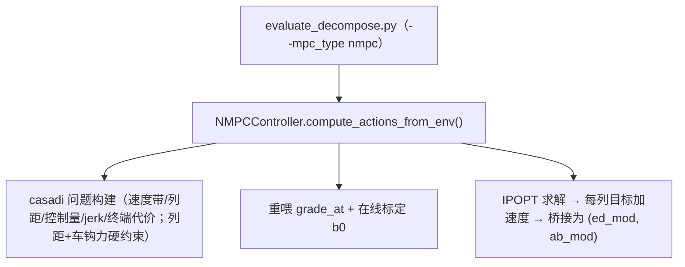

# MPC 对比基线 Knowledge Base

## §0 Contents

| § | Title | When |
|---|------|------|
| §1 | 业务背景与核心概念 | 初次接触本领域 |
| §1.5 | 架构总览 | 快速建立分层调用模型 |
| §2 | 核心流程（求解与桥接） | 改 NMPC/跑对比前 |
| §2.5 | 物理路径速查 | 直接定位代码目录 |
| §3 | 代码入口索引 | 按改动场景找入口 |
| §4 | 目标/约束规格索引 | 改优化问题前 |
| §5 | 调用与运维索引 | 跑 MPC 实验前 |
| §6 | 核心规则与隐藏约束 | 改码前必扫 |
| §7 | 验证路径 | 改动后如何验证 |
| §8 | 相关文档 | 跨领域阅读 |
| §9 | 覆盖与待填 | 文档置信度与缺口 |

## §1 业务背景与核心概念

论文对比实验的唯一 MPC 基线 = **NMPCController**（ADR-022；旧 `FairMPCController`/简化 MPC 已删除，历史 MPC 数值作废）。对比规范（ADR-016，用户口径：只留"逐线公平标定"一种比法）：不按坡道换 MPC 模型；MPC 逐线重喂该线 `grade_at` 图纸 + 在线标定 b0（公平标定），D-RL 跨线严格零微调。立论 = **免重辨识成本**。

技术构成：casadi + IPOPT；列内**集中质量（lumped）多体**（ADR-022 术语）；MT-2 车钩；Regime A 逐线 `grade_at` 重喂与在线标定 b0。

## §1.5 架构总览



## §2 核心流程（求解与桥接）

`compute_actions_from_env()`（nmpc_controller.py）：
1. 首次调用按编组构建 casadi 优化问题；
2. 从 env 快照状态、重建 `grade_at` 坡度图纸、设初值；
3. IPOPT 求解，记录 `solve_times` / `solve_statuses`；
4. 输出每列目标加速度，经桥接逻辑反解为规则基线的加性调制 `(ed_mod, ab_mod)`，保证与 D-RL 动作权限一致（与 `inner_rule_cyclic` 公平对比）。

## §2.5 物理路径速查

| 目录/文件（相对仓库根） | 内容 | 关键符号 |
|------|------|--------|
| traffic_rl_project/src/controllers/nmpc_controller.py | 唯一 MPC 基线 | NMPCController |
| traffic_rl_project/src/controllers/multi_loco_controller.py | 调制落点 | get_action_decomposed() |
| traffic_rl_project/src/evaluation/evaluate_decompose.py | MPC 评估挂载/桥接 | --mpc_type nmpc |
| traffic_rl_project/tests/test_nmpc_controller.py | 求解器测试 | |
| traffic_rl_project/tests/test_metric_accounting.py | 状态残留/solve_statuses 回归 | |

## §3 代码入口索引

| 场景 | 入口 | 符号 | 说明 |
|---|---|---|---|
| 改优化问题 | nmpc_controller.py | 问题构建段 | 决策变量=每机车 ED 调制 |
| 改求解流程 | nmpc_controller.py | `compute_actions_from_env()` | 首调建问题，随后复用 |
| 重置状态 | nmpc_controller.py | `reset()` | 每回合必须调 |
| 跑 MPC 对比 | evaluate_decompose.py | `--mpc_type nmpc` | 唯一合法取值 |
| MPC→动作桥接 | evaluate_decompose.py | 桥接段 | 目标加速度→(ed_mod, ab_mod) |

## §4 目标/约束规格索引

| 项 | 内容 | 说明 |
|---|---|---|
| 决策变量 | 每机车 ED 调制 | 与 D-RL 权限对齐 |
| 目标函数 | 速度带 + 列距 + 控制量 + jerk + 终端代价 | |
| 硬约束 | 列距 + 车钩力 | 车钩力≤1000 kN 同底线 |
| 标定 | 在线标定 b0 | 逐线公平标定（ADR-016） |
| 坡度 | 逐线重喂 `grade_at` | 共用 GradeProfile 接口 |

## §5 调用与运维索引

| 事项 | 入口/位置 | 说明 |
|---|---|---|
| casadi 依赖冒烟 | `python -c "import casadi; print(casadi.__version__)"` | 一次性检查即可（原 tmp 冒烟脚本已按"用后即删"清理） |
| MPC 运行成本提示 | docs/REPRODUCIBILITY.md §十 | 跑前先看成本 |
| 求解失败统计 | evaluate_decompose.py | 非 optimal 计数 |

## §6 核心规则与隐藏约束

- **AI pitfall**【状态残留】`--n_seed` 多回合复用同一 env 时，每回合开始必须 `_mpc.reset()`（历史 bug，有回归测试）。
- **AI pitfall**【solve_statuses】读取求解状态用 `getattr` 兜底（缺失不崩溃）；`NMPCController` 负责记录并清空 `solve_statuses`。
- 【唯一基线】只认 `NMPCController` + `--mpc_type nmpc`；任何"简化 MPC/旧 Fair"数值已作废（ADR-022）。
- 【公平标定】MPC 逐线重喂该线 `grade_at` + 在线标定 b0；D-RL 跨线零微调——改标定逻辑 = 改对比公允性，须走 ADR。
- 【权限对齐】MPC 输出经桥接为 `(ed_mod, ab_mod)` 调制，不得直接给原始加速度当动作。
- 【术语】"多体" = 集中质量（lumped）多体（ADR-022）。

## §7 验证路径

```sh
cd /mnt/d/Code/MultiAgent/traffic_rl_project
python -m pytest tests/test_nmpc_controller.py tests/test_metric_accounting.py -q
```

## §8 相关文档

- ~~`docs/logs/HANDOFF_2026-09-22.md`~~：MPC 对比基线专项交接（**已删除**，git 历史可查；现状以本文件 + ADR 为准）
- `docs/logs/decisions/DECISIONS.md`：ADR-016 / ADR-022
- `docs/REPRODUCIBILITY.md` §十：MPC 成本提示
- `TRAIN_DYNAMICS_KNOWLEDGE_BASE.md`：共用物理与 `grade_at`

## §9 覆盖与待填

- 代码推断覆盖：求解流程/桥接/历史修复已核对符号（2026-10-08）。
- 待填：目标函数各项权重数值未展开（以代码为准）；b0 标定算法细节未展开。
- 用户经验输入：本次未做 Intake 问答。

<!-- Generated by doc-init on 2026-10-08; positioning: AI 改 NMPC/跑 MPC 对比前的速查 -->
