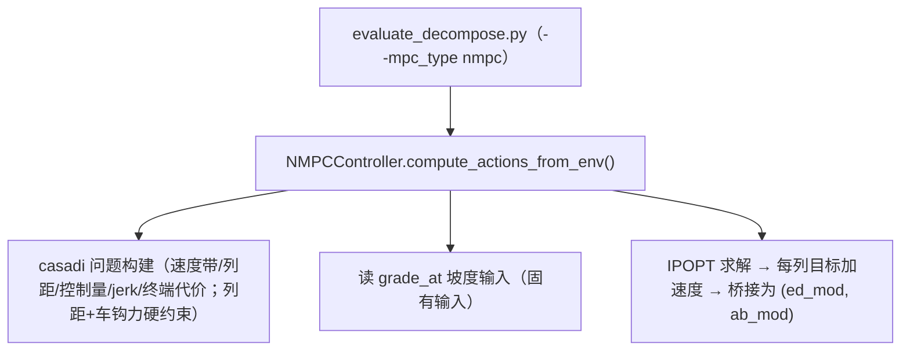

# MPC 对比基线 Knowledge Base

> **⚠️ 状态（2026-11-09 立案 NMPC 删除，ADR-062；2026-11-18 更新 Tube MPC 现状）**：**NMPC 代码已全量删除**（`nmpc_controller.py` 及 evaluation 桥接；ADR-042 已使其退出主表），本文 §2–§5 的 NMPC 求解/桥接/运维内容**降为历史参考，不再对应任何现存代码**。主表 MPC 基线 = **Tube MPC**（following Song2026），**代码侧已实现（2026-11-14）并已产出正式对照行**——**现状、代码地图、正式数字、作废产物清单一律看 §10**，其余各节凡与 §10 冲突处以 §10 为准。

## §0 Contents

| § | Title | When |
|---|------|------|
| §1 | 业务背景与核心概念 | 初次接触本领域 |
| §1.5 | 架构总览 | 快速建立分层调用模型 |
| §2 | 核心流程（求解与桥接） | 改 NMPC/跑对比前 |
| §2.5 | 物理路径速查 | 直接定位代码目录 |
| §3 | 代码入口索引 | 按改动场景找入口 |
| §4 | 目标/约束规格索引 | 改优化问题前 |
| §5 | 调用与运维索引 | 跑 MPC 实验前 |
| §6 | 核心规则与隐藏约束 | 改码前必扫 |
| §7 | 验证路径 | 改动后如何验证 |
| §8 | 相关文档 | 跨领域阅读 |
| §9 | 覆盖与待填 | 文档置信度与缺口 |
| §6B | Tube MPC 移植设计（2026-11-13 夜定稿） | **只作历史设计规格**；实现结果看 §10 |
| §10 | **Tube MPC 实现现状与主仓口径** | **跑/引用任何 MPC 基线数字前必读**；改 MPC 代码前必读 |

## §1 业务背景与核心概念

论文对比实验的唯一 MPC 基线代码 = **NMPCController**（ADR-022；旧 `FairMPCController`/简化 MPC 已删除，历史 MPC 数值作废）。对比口径（ADR-037，废止 ADR-016 Regime A 协议）：不按坡道换 MPC 模型；同一仿真器、同一环境与坡度数据、同档调参力度——坡度是 MPC 预测模型的**固有输入**（图纸天然先于运营存在），**不设"逐线重喂 `grade_at`/在线标定 b0"协议，也不作"免重辨识成本"叙事**；D-RL 跨线严格零微调。立论 = **相对传统基线的编队指标收益**（ADR-042，2026-10-19；旧"编队上下文协同增益"随独立消融废除）。**⚠️ 主表角色已由 ADR-034（2026-10-13）修订：NMPC 退出主表**（related work 文本，"方法与场景不匹配，忠实复现不成立"）；**主表 MPC 行 = Tube MPC**（following Song2026 虚拟编组管式预测控制架构，车钩力口径见 `RESEARCH_POSITIONING.md` §1.2；主对比**同一 MT-2 物理，MPC 侧不建模/不约束车钩力**（原「物理关闭车钩力」口径已由 **ADR-042 附段（2026-11-14）**改述为「控制器侧关闭车钩模型」——零阻抗会把列车解体，判死依据见 §10.3），同仿真器 + 同档调参力度；**只主张编队指标胜出，绝不主张车钩指标胜出**；ADR-042）。

技术构成：casadi + IPOPT；列内**集中质量（lumped）多体**（ADR-022 术语）；MT-2 车钩；坡度经 `grade_at` 接口读入（固有输入，非重喂）。

## §1.5 架构总览



## §2 核心流程（求解与桥接）

`compute_actions_from_env()`（nmpc_controller.py）：
1. 首次调用按编组构建 casadi 优化问题；
2. 从 env 快照状态、读入 `grade_at` 坡度（固有输入）、设初值；
3. IPOPT 求解，记录 `solve_times` / `solve_statuses`；
4. 输出每列目标加速度，经桥接逻辑反解为规则基线的加性调制 `(ed_mod, ab_mod)`，保证与 D-RL 动作权限一致（与 `inner_rule_cyclic` 公平对比）。

## §2.5 物理路径速查

| 目录/文件（相对仓库根） | 内容 | 关键符号 |
|------|------|--------|
| traffic_rl_project/src/controllers/nmpc_controller.py | 唯一 MPC 基线 | NMPCController |
| traffic_rl_project/src/controllers/multi_loco_controller.py | 调制落点 | get_action_decomposed() |
| traffic_rl_project/src/evaluation/evaluate_decompose.py | MPC 评估挂载/桥接 | --mpc_type nmpc |
| traffic_rl_project/tests/test_nmpc_controller.py | 求解器测试 | |
| traffic_rl_project/tests/test_metric_accounting.py | 状态残留/solve_statuses 回归 | |

## §3 代码入口索引

| 场景 | 入口 | 符号 | 说明 |
|---|---|---|---|
| 改优化问题 | nmpc_controller.py | 问题构建段 | 决策变量=每机车 ED 调制 |
| 改求解流程 | nmpc_controller.py | `compute_actions_from_env()` | 首调建问题，随后复用 |
| 重置状态 | nmpc_controller.py | `reset()` | 每回合必须调 |
| 跑 MPC 对比 | evaluate_decompose.py | `--mpc_type nmpc` | 唯一合法取值 |
| MPC→动作桥接 | evaluate_decompose.py | 桥接段 | 目标加速度→(ed_mod, ab_mod) |

## §4 目标/约束规格索引

| 项 | 内容 | 说明 |
|---|---|---|
| 决策变量 | 每机车 ED 调制 | 与 D-RL 权限对齐 |
| 目标函数 | 速度带 + 列距 + 控制量 + jerk + 终端代价 | |
| 硬约束 | 列距 + 车钩力 | 车钩力≤1000 kN 同底线 |
| 标定 | 无逐线标定协议（ADR-037 废止） | 同档调参力度 |
| 坡度 | `grade_at` 固有输入 | 共用 GradeProfile 接口 |

## §5 调用与运维索引

| 事项 | 入口/位置 | 说明 |
|---|---|---|
| casadi 依赖冒烟 | `python -c "import casadi; print(casadi.__version__)"` | 一次性检查即可（原 tmp 冒烟脚本已按"用后即删"清理） |
| MPC 运行成本提示 | docs/REPRODUCIBILITY.md §十 | 跑前先看成本 |
| 求解失败统计 | evaluate_decompose.py | 非 optimal 计数 |

## §6 核心规则与隐藏约束

- **AI pitfall**【状态残留】`--n_seed` 多回合复用同一 env 时，每回合开始必须 `_mpc.reset()`（历史 bug，有回归测试）。
- **AI pitfall**【solve_statuses】读取求解状态用 `getattr` 兜底（缺失不崩溃）；`NMPCController` 负责记录并清空 `solve_statuses`。
- 【唯一基线】只认 `NMPCController` + `--mpc_type nmpc`；任何"简化 MPC/旧 Fair"数值已作废（ADR-022）。
- 【对比口径】同一仿真器/环境/坡度数据/调参力度；坡度为固有输入，**不设逐线重喂与标定协议**（ADR-037）；D-RL 跨线零微调——改对比口径须走 ADR。
- 【权限对齐】MPC 输出经桥接为 `(ed_mod, ab_mod)` 调制，不得直接给原始加速度当动作。
- 【术语】"多体" = 集中质量（lumped）多体（ADR-022）。

## §7 验证路径

```sh
cd traffic_rl_project
python -m pytest tests/test_tube_mpc_baseline.py -q        # 在役（12 项，2026-11-18 复验通过）
python -m pytest tests/test_metric_accounting.py -q          # 指标记账回归
```

> `tests/test_nmpc_controller.py` 已随 ADR-062 删除（原指针为断链，2026-11-18 更正）。

## §8 相关文档

- ~~`docs/logs/HANDOFF_2026-09-22.md`~~：MPC 对比基线专项交接（**已删除**，git 历史可查；现状以本文件 + ADR 为准）
- `docs/logs/decisions/DECISIONS.md`：ADR-016 / ADR-022
- `docs/REPRODUCIBILITY.md` §十：MPC 成本提示
- `TRAIN_DYNAMICS_KNOWLEDGE_BASE.md`：共用物理与 `grade_at`

## §9 覆盖与待填

- 代码推断覆盖：求解流程/桥接/历史修复已核对符号（2026-10-08）。
- 待填：目标函数各项权重数值未展开（以代码为准）；b0 标定算法细节未展开。
- 用户经验输入：本次未做 Intake 问答。
- **2026-11-18 更新**：Tube MPC 已实现并出正式对照行，现状、代码地图、数字与作废清单落 **§10**（原「待填：NMPC 目标函数权重/b0 标定细节」属历史 NMPC 范畴，不再补）。

<!-- Generated by doc-init on 2026-10-08; positioning: AI 改 NMPC/跑 MPC 对比前的速查 -->

## §6B Tube MPC 移植设计（2026-11-13 夜定稿；**历史设计规格**，实现照此执行后已完成）

> ⚠️ 本节原编号与 §6「核心规则与隐藏约束」重号，2026-11-18 改为 §6B。本节是**设计稿**，实现结果与现状以 §10 为准。

> **触发**：ADR-067 更正段（23:35）恢复 Tube MPC 为主表必需对照（ADR-042 两基线之一）。**本节即实现规格，代码照此写。**
> **源代码**：`zba` 分支 `MPC-baseline/song2026_tubempc/`（已 worktree 检出 `D:\Code\MultiAgent\traffic_rl_zba\`）。

### 三层架构（求解器原样复用，只换状态与执行）

| 层 | 内容 | 来源 | 工作量 |
|---|---|---|---|
| L1 求解器 | `TubeMPC.solve(x0, v_ref0, a_ref, d2) → û*`（146 行纯数学：4 维误差状态增广 + SLSQP + tube 反馈 + 终端约束） | zba `tube_mpc.py` **原样复用** | 半天（仅参数对齐） |
| L2 状态构造 | 主仓 `TrainFleetEnv` 3 列状态 → `x0=[s_e1,v_e1,s_e2,v_e2]`。**参考轨迹 = 主仓 ref_speed_table（现成！v7 奖励同源）**，s_e/v_e = 实际(里程,速度) − 参考 | 新写适配器 | 半天 |
| L3 执行 | û（连续加速度，m/s²）→ 主仓 ED/AB 物理执行：`thr/ed` 走主仓 `electric_brake_force_n`，AB 档走 `AirBrakeNotch`——**zba `shuohuang_sim.py:397-444` 已有此逻辑且已调用主仓函数，照搬** | zba 已有 | 半天 |
| 挂载 | `evaluate_decompose.py --mpc_type tube`（NMPC 挂载先例在 git 历史） | 新写 | 半天 |

**总工作量 ≈ 2 天**（与 ADR-067 更正段估计一致）。

### L1 参数对齐表（zba → 主仓，逐项核对）

| zba 参数 | 含义 | 主仓对应 | 备注 |
|---|---|---|---|
| `M_LOCO` | 机车质量 | **188 t**（consist_10kt_1plus0，HXD3B） | zba=200 t（HXD1 反推）⇒ 改 188 |
| `M_WAGON_GROUP` | 货车组质量 | **10 800 t**（108×100 t） | **zba=2 692 t，差 4 倍**——`pair_A` 的 ξ、扰动界折算全部按主仓质量重算；这是参数对齐最大的一项 |
| `U_MAX` / `U_MIN` | 机车牵引/电制动限 | 牵引按粘着 1 659 kN（起步）/功率限制；电制动 547 kN 级 | zba=760/−470（HXD1）⇒ 按主仓 9 600 kW/188 t 重算 |
| `C0/C1/C2` | Davis 阻力系数 | 主仓 `_resistance_forces` 的单位阻力模型 | **两套阻力式不同，须换算成 zba 形式或改 MPC 预测用主仓式** |
| `DT_MPC` / `H_PRED` | 决策间隔/预测步 | **zba=1.0 s 与主仓 decision_interval=10×dt=0.1 恰好一致，无需改** ✅ | H=5 × 1 s = 5 s 预测视界；ADR-064 的 91 s 是学习视界（γ），MPC 预测视界是另一概念，不强求一致 |
| `W_LIM_KN` | 车钩补偿残余扰动界 | Song2026 ±1500 kN；**本方案显式关车钩约束（ADR-034），W 取残余小值** | 论文红线：不比车钩 |
| `V_LIM` | 速度带半宽 | **75 km/h 口径** | zba=80/3.6 ⇒ 改 75/3.6（ADR-068） |
| `SE_COUPLE_LIM` | 间距误差限 | d_eff=128.7（75 口径） | 对齐 ADR-068 |

### L2 状态构造的三个决定

1. **参考轨迹直接用 `ref_speed_table`**（75 口径表，与 D-RL 同源）——这同时满足"公平标定"（两方法跟同一条参考线）。
2. **车 1 = 领航列，车 2/3 = 跟随列**（x0 的 s_e2/v_e2 是前车实际状态 − 期望间距，Song2026 式 20）。三列 = 3 个 TubeMPC 实例（idx 0/1/2），与 3 智能体 MARL 对称。
3. **起点/编组/工况与 D-RL 完全一致**（4300 m 固定起点、10 kt 1+108、朔黄 49.6 km、主对比关车钩物理——ADR-042）。

### 陷阱清单（NMPC 时代教训，硬红线）

1. **【权限对齐】** Tube MPC 是**独立基线**：û 直接物理执行（thr/ed/notch），**不走 `(ed_mod, ab_mod)` 调制**——NMPC 的 clip 带宽陷阱（MPC 期望 ED [0,0.75] vs 规则基线 [0,1]，455 步越权，ADR-022/044）在调制架构下才存在。
2. **【不比车钩】** 写作红线（ADR-033）：Formation-MPC 显式关车钩约束，**只主张编队指标（列距/速度带）胜出**。
3. **【metadata】** 评估落权威 metadata（AGENTS 红线 5），`--mpc_type tube` + 配置 + 求解器参数全记录。
4. **【ED 下限】** û<0 时 ED 深度映射不得被 `ed_zero_point=0.77` 类钳制——那是 notch 动作空间的参数，MPC 走自己的执行通道。

### 分解到执行（明天起）

1. D+1 上午：L1 参数对齐（逐项核对表）+ `TubeMPC` 单测（solve 数值 sanity：零误差状态 → û≈0）
2. D+1 下午：L2 状态构造器 + 与 ref 表对接
3. D+2：L3 执行器 + `evaluate_decompose` 挂载 + 200 步冒烟
4. D+2 晚：全程评估 1 seed（若 MPC 求解 74 ms/步级 ⇒ 全程 ≈ 0.74 h，NMPC 先例）

### §6 修订（2026-11-13 23:59，读毕复现报告全文后的重大更新）

> **读毕 `zba` 复现报告 §4 全文后，本节上半部分的两个前提要修**：
> ① 「plant 不同源只剩 plant.py」**不成立**——§4 朔黄 53.5 km（**文献/zba 侧里程，非主仓场景里程**，口径见 §10.6）仿真的被控对象就是**主库 `TrainDynamics`（MT-2 / Newmark-β / 牵规法，物理层未改一行）**，逐车建模 55 质点/列，`tube_mpc.py` 一行未改。LRN-20261113-001 已加更正。
> ② 「2 天移植」高估——**适配层（执行 / 参考律 / 列间安全包络 / 消融开关）是现成代码**，剩余工作 = **场景参数适配**（编组 5 600→10 988 t、剖面 53.5→49.6 km【两个里程分属文献侧与主仓侧，见 §10.6】、起点与定距对齐 ADR-068），**约 1 天**。

**§4 现成可搬的适配层资产（全部已在 zba 侧 51.8 km 剖面【非主仓里程】的主库物理上验证）**：

| 资产 | 位置（shuohuang_sim.py） | 对我们的价值 |
|---|---|---|
| MPC→ED/AB 执行链（`electric_brake_force_n` / `AirBrakeNotch` / `tractive_force`） | :397-444 | L3 执行器照搬 |
| 列间安全包络（ETCS 式 `v_allow`，防数学穿透） | v2 改进 1 | 主对比关车钩物理时的防穿透保障 |
| 电制动限幅 `p_d≤0.8`（文献式 2-25）+ 低速强制缓解（**文献式 2-26**） | v2 改进 2 | **V16 缺口①②的文献出处**——notch 机制修复有双源支撑 |
| 电制动/空气制动分工仲裁（AB 已施加且近参考 ⇒ ED 上限 0.2） | v2 改进 2 | 实现层修复可借鉴 |
| 限速预览 + 跟随车参考律 | v2 改进 3 | 主仓场景适配直接用 |

**结论（主表 Tube MPC 行的剩余工作，约 1 天）**：`tube_mpc.py` 不改；把 `shuohuang_sim.py` 的适配层接到**主仓场景参数**（49.6 km / 10 988 t / 4 300 m / `d_eff` 128.7 / 三条判据口径）；zba 既有数字（686/840/684 kN @5 600 t）作为**中间记录保留**，不进主表（编组不同）。复现的已知偏差（下坡跟踪 5.4 m/s、车钩 809 vs 论文 330 kN）在论文对比节如实引用其解释（循环制动二进制特性 + 论文未公开监督细节）。

## §10 Tube MPC 实现现状与主仓口径（2026-11-14 定稿；自 `MPC_HANDOFF_2026-11-14.md` 迁入，迁入与删除完成于 2026-11-19 凌晨）

> **本节是主表 MPC 行的现状唯一真源。** 与 §1–§6B 冲突处以本节为准：§2–§5 属 NMPC 时代（ADR-062 已删代码），§6B 是 2026-11-13 夜的设计稿（其两个前提已被 §6 修订段更正）。原始交接件 `MPC_HANDOFF_2026-11-14.md` 已按根 `AGENTS.md`「HANDOFF 生命周期」在迁移完成后删除。基线版原文：`git show 65db1bf:traffic_rl_project/MPC_HANDOFF_2026-11-14.md`（该件只有一次提交）；其工作树增量的 **§0 复核段（2026-11-14 11:30 起，+21/−6）从未提交**，实质内容已全量落入下面 §10.2–§10.5，故不再另存该段原文。

### 10.1 代码地图与验证状态（在役）

| 文件 | 内容 | 状态 |
|---|---|---|
| `src/mpc_baseline/params.py` | 主仓口径参数：`M_LOCO=188 t`(L19)、`M_WAGON_GROUP=5400 t`(L20)、`V_LIM=75/3.6`(L38)、**`D_DES=1424.7 m`**(L51 = 车长 1296 + 75 口径 `d_eff` 128.7)、`R_CYCLE=50 kPa`(L59)、`DT_MPC=1.0 s`(L15)、`SUB=10`(L63)；Song2026 表 3 权重 Q=diag(0.5,0.5)/R=0.1/P=diag(0.6,0.4) 原样保留 | ✅ |
| `src/mpc_baseline/tube_mpc.py` | 求解器：zba `tube_mpc.py`（146 行）**逐行保真移植，只换 import**；接口 `solve(x0, v_ref0, a_ref, d2) → û*`（4 维误差状态增广 + SLSQP + tube 反馈 + 终端约束） | ✅ |
| `src/evaluation/evaluate_mpc_tube.py` | L2 状态构造（误差状态 **`x0[1]=v_ref−v_actual`**，正=低于参考）+ L3 执行器（û→thr/ED/AB 反解；50 kPa 初减压 + **缓解后 45 s** 充风门控 `:118-134`；AB 迟滞 ±0.5 km/h `:130/133`）+ ETCS 式列间安全包络（`A_EB=0.15 m/s²`、`MIN_GAP_AIR=150 m`，`:48-49/91-94`）+ `speed_guard`（`:105-112`）+ 主表指标 | ✅ v3 |
| `tests/test_tube_mpc_baseline.py` | 12 项：零误差→零输入 / 方向性（低于参考给牵引、高于参考给制动）/ 阻尼符号 / 输入收紧边界 / tube 宽度 / 主仓参数抽查 / 求解状态回报 / **名义状态重置** / **45 s 充风门控** / **超速保护** / **零车钩→零接口力** | ✅ **12/12**（2026-11-18 复验） |

- 运行方式（主对比 = MT-2，见 §10.3）：`python src/evaluation/evaluate_mpc_tube.py --out_dir <dir> --coupler mt2 --max_steps 31500 --seed 0`；`--atp` **未接入执行链，传入即 `SystemExit`**（`:144-147`），不得用它产出 ATP 指标。
- 2026-11-14 记录的更大范围回归：动力学 + 制动传播 + MPC **合计 48 passed**；600 步零车钩冒烟末速 70.0 km/h、band 100%、min head gap 1422.1 m、min 尾端净空 128.69 m。**冒烟只作活性校验，不作峰值/安全判据**（红线 3）。
- 未提交状态（截至 2026-11-18）：上述 4 个文件仍有工作树改动未 commit，属 MPC 线 owner 在途资产，**本节只记录已核实的行为，不替代代码审查**。

### 10.2 v2「四问题」复核结论（2026-11-14 11:30）——三项不是缺陷，三项才是

**不得再作为缺陷引用（误判/误读）**：

1. `gap_lead` 前 ~1300 s 的 2465 个 NaN **全部属于无前车的领航列**，两条跟随列全程有限 ⇒ 「列间包络早期失效」不成立，包络公式未改。
2. v2 metadata 是 `coupler=mt2`，1296 kN 不是「零车钩却非零」⇒ fc 语义并无 bug。
3. 「只跑 7395 步就提前终止」是报表误读：**7395 = 2465 决策步 × 3 列**的日志行数；领航列在下一控制步越过 49600 m 后按主环境协议正常截止。已修 `steps`/`full_route`/末速口径并记录三列末位置。

**真根因（v3 已修，改代码前必须知道）**：

1. `cycle_brake` 读取不存在的 `dyn.t`，且把「**缓解后 45 s 充风**」写成「施加 45 s 后缓解」——因果方向反了（现为 `t_now - t_rel >= 45`，施加时长不设上限）。
2. 主循环未每步令 `xbar = x0` ⇒ tube 反馈**重复叠加状态误差**（现由「名义状态重置」单测守住）。
3. MPC 在机车-货车组速度差耦合下可返回近零/正输入，前馈又抵消 AB/坡度分力 ⇒ **超速时反而补牵引**。已加 `speed_guard`：超参考 0.5 m/s ⇒ 零牵引 + 满 ED（与主环境 ATP 兜底语义一致；AB 仍归循环制动状态机）。

### 10.3 主对比被控对象 = MT-2（owner 2026-11-14 17:37 拍板）⛔ 零阻抗判死

- **判死依据（一手）**：`--coupler zero` 短窗中机车-货车组速度差最低 **−23.6 m/s**（列车解体），600 步实际轨迹 SLSQP 成功率仅 **2.9%**（平均 5.86 次多起点/步）⇒ 零阻抗结果只能当「物理关闭不可行」的诊断，**不能进主表**。
- **拍板**：MPC 主对比改用 **MT-2 被控对象**；MPC 仍**不建模、不约束车钩力**，只在写作上关闭车钩主张。原 ADR-042「物理关闭车钩力」改述为「**控制器侧关闭车钩模型**」。正本：`DECISIONS.md` **ADR-042 附段（2026-11-14 拍板，2026-11-18 落痕）**。
- MT-2 下读到的车钩力仅作物理诊断：metadata `coupler_reporting = "mt2_physical_diagnostic_not_mpc_claim"`。

### 10.4 正式 MPC 对照行（一手：`outputs/results/mpc_baseline/tube_v3_mt2_20261114_r2/result.json`）

| 字段 | 值 | 备注 |
|---|---|---|
| `steps` / `full_route` | 2467 / true | 跑满 `route_end_m=49600` |
| `peak_coupler_kN` | **1384.587** | 逐列 [1136.0, 1384.3, 1384.6]；**高于规则基线 1294** |
| `band_rate` | **0.96311** | 领航机车在 [40, 75] km/h 绝对带内步占比（口径见下） |
| `d_eff_m` | 128.700 | 75 口径（ADR-067/068） |
| `gap_err_mean_abs_m` / `gap_err_peak_abs_m` | 140.073 / 359.033 | 对 `D_DES=1424.7` |
| `min_gap_m` / `rear_end_steps` | **−309.158 / 789** | 无碰撞模型下的**列间物理穿透**，TrainDynamics 未阻止 |
| `min_gap_head_m` | 988.909 | 头对头最小值 |
| `ab_steps` / `ab_agent_ratio` | 2455 / [0.920, 0.924, 0.890] | 逐列 AB 占比 |
| `mean_ed` / `cycle_brake_train_steps` | 0.47934 / 6746 | |
| `atp_interventions` | **null** | `not_available_in_independent_tube_mpc_entry` ⇒ **MPC 行无 ATP 口径，不得与规则基线 15547 / D-RL 横向比较** |
| `solve_ms_mean` / 成功率 / 均次数 | 6.171 / 1.0 / 1.037 | 全程墙钟 782.9 s |
| `final_head_speeds_kmh` / `final_head_positions_m` | [59.378, 67.790, 69.151] / [49608, 48149, 46551] | 领航列末速 59.4 |

- **只可引用 `_r2`**；同目录 `tube_v3_mt2_20261114/` 是同峰同带的前次跑，`full_route` 报表误报 false。
- **本行是「对照行」不是「通过行」**：peak 高于规则基线、band 低于 100%、且有 789 步穿透。主表引用时必须并列这三点。
- **`band_rate` 口径**（`evaluate_decompose.py:418-419`，MPC 侧同定义）：`vel = env.trains[0].dynamics.vel[0]`（**只统计领航机车**），`v_min ≤ vel ≤ v_max`，边界是**绝对带 [40, 75] km/h**（不是 40–80，不是 ref±带宽，也不是分段限速）。 ⇒ band 掉分的主要形态是**领航机车跑在 75 km/h 之上**，与「少制动换更快」同源。
- **指标语义分家（最易混，写表必查）**：`viol` = 车钩力**超限**计数（`evaluate_decompose.py:383/358`，`|f| > 1e6 N`）；`rear_end_steps` = **物理穿透**计数（`:430`，`gap_min_m ≤ 0`；MPC 侧 `evaluate_mpc_tube.py:299`）。⇒ **MPC r2 的 789 是穿透**；nincr ep10 的 **576 是超限**（其 `rear_end_steps = 0`，零穿透）。两者不得互称。
- **⚠️ 列距误差的参照值也不同源（H1 可比性前提，2026-11-19 一手核实）**：MPC 侧 `gap_err = gap_head − D_DES`（`evaluate_mpc_tube.py:295`）= **对固定 1,424.7 m 头距**的偏差，等价于"净空对固定 128.7 m"；RL/规则侧 `_gap_metrics` 用 `gap − 1.1·d_safe`（`train_fleet_env.py:1509`）= **对动态 ATP 净空**的偏差。两者在 70 km/h 附近重合（`d_eff=128.7` 就是该口径下的取值），**速度一偏离参考就分叉** ⇒ 主表 H1「列距保持优于两基线」要么统一到动态 `d_eff` 后重算，要么在表注里写明参照差异，**不得直接并排 140.1 / 24.5 / 457.1 这三个数**。
- **⚠️ 计数单位也不同源（10× 陷阱，2026-11-19 一手核实）**：`evaluate_decompose.py` 的循环 `for i in range(max_steps)` 每迭代 = **1 个 0.1 s 原始步**（RL 动作每 `decision_interval=10` 迭代才重决策）；`evaluate_mpc_tube.py` 每迭代 = **1 个 1.0 s 控制步**（`DT_MPC=1.0`，内部 `SUB=10` ZOH）。⇒ 同一 49.6 km 全程：RL 侧 n = **23,274 原始步**（=2,327 s），MPC 侧 n = **2,467 控制步**（=2,467 s）。⇒ **所有"步数型"绝对计数（`viol` / `rear_end_steps` / `ab_steps` / `overspeed_car_steps`）在 MPC 行与 RL 行之间不可直接比大小，须先乘 `decision_interval` 统一到"秒"**：MPC 789 穿透 = **789 s**，nincr 576 超限 = **57.6 s**。比值型指标（`band_rate`、`p_ab_applied` 等）无量纲，可直接比。

### 10.5 作废 / 不可引用产物

| 产物 | 状态 | 原因 |
|---|---|---|
| `mpc_baseline/tube_v1_20261114/` | ⛔ INVALID | ref 表 `v_mps` 误乘 3.6，参考线 59→212 km/h，MPC 追假参考（末速 159.8）；旁有 `INVALID_V1_UNIT_BUG.txt`。**已修**：tbl_v 直读 + `V_CAP_MPS=75/3.6` 绝对封顶 |
| `mpc_baseline/tube_v2_20261114/` | 历史中间值 | 「四问题」复核前的 v2 产物，其报表口径（steps/band/穿透）当时未修 |
| `mpc_baseline/tube_v3_zero_20261114` / `_r2` / `_r3` | ⛔ 不得引用 | 零阻抗三投**全无 `result.json`**（红线 2/5）；`_r3` 另有 `ABORTED_BY_INTERRUPTION.txt`（2026-11-14 11:34 主动中止：SLSQP 约 60% 失败且原实现静默返回）。其「正式结果将另建 r4」的计划随 owner 改判 MT-2 **作废** |
| `mpc_baseline/tube_v3_mt2_20261114/`（非 `_r2`） | 不引用 | 与 `_r2` 同峰同带，`full_route` 误报 false |
| zba v2 朔黄数字 686/840/684 kN @5600 t | 中间记录 | 编组/线路非主仓口径，不进主表 |
| 原交接件 §1 句「正式基线正在 `tube_v3_zero_20261114_r3/` 产出」 | ⛔ 已作废 | 被其 §0 复核段推翻，且该目录已中止、无 result.json |

### 10.6 场景参数卡（当前实现值）与里程口径

| 项 | 值 | 来源 |
|---|---|---|
| 线路 | 主仓 49.6 km 剖面（metadata `route_end_m=49600`） | 主仓 PROFILES；`grade=shuozhou_ningwuxi_beidaniu_49km` |
| 编组 | 10 988 t ×3 列（1+108，HXD3B 188 t / 9600 kW） | `consist_10kt_1plus108` |
| 起点 / 初速 | 4300 m / 60 km/h | ADR-068 |
| 列间头距 | **1424.7 m**（=1296 + 128.7） | 与主仓 env reset 一致 |
| MPC 视界 | H=5 × DT=1.0 s | zba 值恰与主仓 `decision_interval=10×0.1 s` 一致 |
| 循环制动 | 50 kPa 初减压 + **缓解后 45 s** 充风 + AB 迟滞 ±0.5 km/h | Song2026 式 2-24 |
| 安全包络 | `A_EB=0.15 m/s²`、`MIN_GAP_AIR=150 m`、`speed_guard` 0.5 m/s | zba v2 + v3 |
| 参考表 | `refspeed_baseline_20261113_095953/ref_speed_table.npz` | metadata `reference_table`（v_max=75 口径） |

> **里程口径警示（凡出现 53.5 / 51.8 均非主仓场景里程）**：`docs/knowledge/song2026_tubempc_复现报告.md` 的 **53.5 km = 原文坡段表全长（58 段）**、**51.8 km = 其覆盖里程**、**49.527 km = 75→45 限速突变点**；主仓所谓「49.6 km」指**评估里程**（`route_end_m=49600`），不是线路全长。三者不得混写。

### 10.7 物理同源与 zba 分支处置（已定，勿再怀疑）

- zba worktree `D:\Code\MultiAgent\traffic_rl_zba\` 已删除；全部内容保留在 **`zba` 与 `origin/zba`**（提交 `7b79a81`），需要时 `git worktree add ../traffic_rl_zba zba`。复现报告已归档 `docs/knowledge/song2026_tubempc_复现报告.md`。
- 复现报告 §4：朔黄对比的被控对象 = **主库 `TrainDynamics`**（MT-2 / Newmark-β / 牵规法），**物理层未改一行**，逐车 55 质点/列 ⇒ **物理同源已证实**；`LRN-20261113-001` 原判「plant 不同源」只看简化复现层（9 质点 `plant.py`），是误判，已更正。
- 论文场景复现偏差（下坡跟踪 5.4 m/s、车钩 809 vs 论文 330 kN）系论文未公开监督细节 + 循环制动二进制特性，**不改进、不进主表**；主表只需「忠实实现 + 本文场景表现」。

### 10.8 对照纪律（写作红线，未变）

- 对照基线 = 规则层未调参 **1294 kN**（W3-3 定稿：band 100% / ATP 15547 / 末速 59.7，`PROJECT_PIPELINE.md` §0.2 W3 行）+ 本 MPC 行 + D-RL。
- MPC 行不比车钩（ADR-033/034/042 及其附段）；引用任何「更优」必须并列代价口径（ATP、速度带）——2026-11-13 rel60 教训（1213 是 20 倍 ATP 换的）。
- 三方同物理同场景（49.6 km / 10988 t / 4300 m / 60 km/h / `d_eff` 128.7 / 75 口径 ADR-068）⇒ 同源性自动成立；metadata 全记录是引用前提（红线 5）。

### 10.9 未收口（MPC 线 owner）

1. **主表 MPC 行的 ATP 列**：要么在 `evaluate_mpc_tube.py` 接入 ATP，要么主表对 MPC 行明确不设该列（现为显式拒绝 + `null`）。
2. **r2 的 789 步列间穿透如何在主表脚注披露**，未定稿（TrainDynamics 无碰撞模型）。
3. **4 个 MPC 文件的未提交工作树改动**与 2026-11-14 定稿的差异未经复核，也未 commit。
