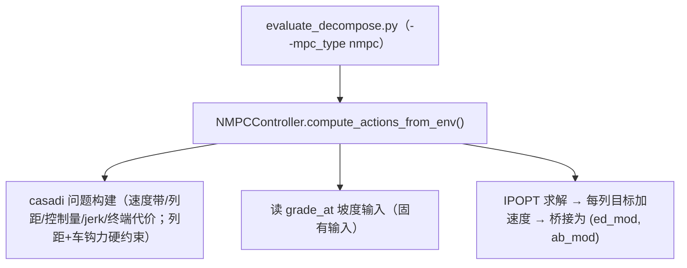

# MPC 对比基线 Knowledge Base

> **⚠️ 状态（2026-11-09，ADR-062）**：**NMPC 代码已全量删除**（`nmpc_controller.py` 及 evaluation 桥接；ADR-042 已使其退出主表）。本文 §2–§5 的 NMPC 求解/桥接/运维内容**降为历史参考，不再对应任何现存代码**。主表 MPC 基线 = **Tube MPC**（following Song2026），**代码侧尚未实现**——实现时本文档须按新架构重写。

## §0 Contents

| § | Title | When |
|---|------|------|
| §1 | 业务背景与核心概念 | 初次接触本领域 |
| §1.5 | 架构总览 | 快速建立分层调用模型 |
| §2 | 核心流程（求解与桥接） | 改 NMPC/跑对比前 |
| §2.5 | 物理路径速查 | 直接定位代码目录 |
| §3 | 代码入口索引 | 按改动场景找入口 |
| §4 | 目标/约束规格索引 | 改优化问题前 |
| §5 | 调用与运维索引 | 跑 MPC 实验前 |
| §6 | 核心规则与隐藏约束 | 改码前必扫 |
| §7 | 验证路径 | 改动后如何验证 |
| §8 | 相关文档 | 跨领域阅读 |
| §9 | 覆盖与待填 | 文档置信度与缺口 |

## §1 业务背景与核心概念

论文对比实验的唯一 MPC 基线代码 = **NMPCController**（ADR-022；旧 `FairMPCController`/简化 MPC 已删除，历史 MPC 数值作废）。对比口径（ADR-037，废止 ADR-016 Regime A 协议）：不按坡道换 MPC 模型；同一仿真器、同一环境与坡度数据、同档调参力度——坡度是 MPC 预测模型的**固有输入**（图纸天然先于运营存在），**不设"逐线重喂 `grade_at`/在线标定 b0"协议，也不作"免重辨识成本"叙事**；D-RL 跨线严格零微调。立论 = **相对传统基线的编队指标收益**（ADR-042，2026-10-19；旧"编队上下文协同增益"随独立消融废除）。**⚠️ 主表角色已由 ADR-034（2026-10-13）修订：NMPC 退出主表**（related work 文本，"方法与场景不匹配，忠实复现不成立"）；**主表 MPC 行 = Tube MPC**（following Song2026 虚拟编组管式预测控制架构，车钩力口径见 `RESEARCH_POSITIONING.md` §1.2；主对比场景物理关闭车钩力，同仿真器 + 同档调参力度；**只主张编队指标胜出，绝不主张车钩指标胜出**；ADR-042）。

技术构成：casadi + IPOPT；列内**集中质量（lumped）多体**（ADR-022 术语）；MT-2 车钩；坡度经 `grade_at` 接口读入（固有输入，非重喂）。

## §1.5 架构总览



## §2 核心流程（求解与桥接）

`compute_actions_from_env()`（nmpc_controller.py）：
1. 首次调用按编组构建 casadi 优化问题；
2. 从 env 快照状态、读入 `grade_at` 坡度（固有输入）、设初值；
3. IPOPT 求解，记录 `solve_times` / `solve_statuses`；
4. 输出每列目标加速度，经桥接逻辑反解为规则基线的加性调制 `(ed_mod, ab_mod)`，保证与 D-RL 动作权限一致（与 `inner_rule_cyclic` 公平对比）。

## §2.5 物理路径速查

| 目录/文件（相对仓库根） | 内容 | 关键符号 |
|------|------|--------|
| traffic_rl_project/src/controllers/nmpc_controller.py | 唯一 MPC 基线 | NMPCController |
| traffic_rl_project/src/controllers/multi_loco_controller.py | 调制落点 | get_action_decomposed() |
| traffic_rl_project/src/evaluation/evaluate_decompose.py | MPC 评估挂载/桥接 | --mpc_type nmpc |
| traffic_rl_project/tests/test_nmpc_controller.py | 求解器测试 | |
| traffic_rl_project/tests/test_metric_accounting.py | 状态残留/solve_statuses 回归 | |

## §3 代码入口索引

| 场景 | 入口 | 符号 | 说明 |
|---|---|---|---|
| 改优化问题 | nmpc_controller.py | 问题构建段 | 决策变量=每机车 ED 调制 |
| 改求解流程 | nmpc_controller.py | `compute_actions_from_env()` | 首调建问题，随后复用 |
| 重置状态 | nmpc_controller.py | `reset()` | 每回合必须调 |
| 跑 MPC 对比 | evaluate_decompose.py | `--mpc_type nmpc` | 唯一合法取值 |
| MPC→动作桥接 | evaluate_decompose.py | 桥接段 | 目标加速度→(ed_mod, ab_mod) |

## §4 目标/约束规格索引

| 项 | 内容 | 说明 |
|---|---|---|
| 决策变量 | 每机车 ED 调制 | 与 D-RL 权限对齐 |
| 目标函数 | 速度带 + 列距 + 控制量 + jerk + 终端代价 | |
| 硬约束 | 列距 + 车钩力 | 车钩力≤1000 kN 同底线 |
| 标定 | 无逐线标定协议（ADR-037 废止） | 同档调参力度 |
| 坡度 | `grade_at` 固有输入 | 共用 GradeProfile 接口 |

## §5 调用与运维索引

| 事项 | 入口/位置 | 说明 |
|---|---|---|
| casadi 依赖冒烟 | `python -c "import casadi; print(casadi.__version__)"` | 一次性检查即可（原 tmp 冒烟脚本已按"用后即删"清理） |
| MPC 运行成本提示 | docs/REPRODUCIBILITY.md §十 | 跑前先看成本 |
| 求解失败统计 | evaluate_decompose.py | 非 optimal 计数 |

## §6 核心规则与隐藏约束

- **AI pitfall**【状态残留】`--n_seed` 多回合复用同一 env 时，每回合开始必须 `_mpc.reset()`（历史 bug，有回归测试）。
- **AI pitfall**【solve_statuses】读取求解状态用 `getattr` 兜底（缺失不崩溃）；`NMPCController` 负责记录并清空 `solve_statuses`。
- 【唯一基线】只认 `NMPCController` + `--mpc_type nmpc`；任何"简化 MPC/旧 Fair"数值已作废（ADR-022）。
- 【对比口径】同一仿真器/环境/坡度数据/调参力度；坡度为固有输入，**不设逐线重喂与标定协议**（ADR-037）；D-RL 跨线零微调——改对比口径须走 ADR。
- 【权限对齐】MPC 输出经桥接为 `(ed_mod, ab_mod)` 调制，不得直接给原始加速度当动作。
- 【术语】"多体" = 集中质量（lumped）多体（ADR-022）。

## §7 验证路径

```sh
cd traffic_rl_project
python -m pytest tests/test_nmpc_controller.py tests/test_metric_accounting.py -q
```

## §8 相关文档

- ~~`docs/logs/HANDOFF_2026-09-22.md`~~：MPC 对比基线专项交接（**已删除**，git 历史可查；现状以本文件 + ADR 为准）
- `docs/logs/decisions/DECISIONS.md`：ADR-016 / ADR-022
- `docs/REPRODUCIBILITY.md` §十：MPC 成本提示
- `TRAIN_DYNAMICS_KNOWLEDGE_BASE.md`：共用物理与 `grade_at`

## §9 覆盖与待填

- 代码推断覆盖：求解流程/桥接/历史修复已核对符号（2026-10-08）。
- 待填：目标函数各项权重数值未展开（以代码为准）；b0 标定算法细节未展开。
- 用户经验输入：本次未做 Intake 问答。

<!-- Generated by doc-init on 2026-10-08; positioning: AI 改 NMPC/跑 MPC 对比前的速查 -->

## §6 Tube MPC 移植设计（2026-11-13 夜定稿；实现照此执行）

> **触发**：ADR-067 更正段（23:35）恢复 Tube MPC 为主表必需对照（ADR-042 两基线之一）。**本节即实现规格，代码照此写。**
> **源代码**：`zba` 分支 `MPC-baseline/song2026_tubempc/`（已 worktree 检出 `D:\Code\MultiAgent\traffic_rl_zba\`）。

### 三层架构（求解器原样复用，只换状态与执行）

| 层 | 内容 | 来源 | 工作量 |
|---|---|---|---|
| L1 求解器 | `TubeMPC.solve(x0, v_ref0, a_ref, d2) → û*`（146 行纯数学：4 维误差状态增广 + SLSQP + tube 反馈 + 终端约束） | zba `tube_mpc.py` **原样复用** | 半天（仅参数对齐） |
| L2 状态构造 | 主仓 `TrainFleetEnv` 3 列状态 → `x0=[s_e1,v_e1,s_e2,v_e2]`。**参考轨迹 = 主仓 ref_speed_table（现成！v7 奖励同源）**，s_e/v_e = 实际(里程,速度) − 参考 | 新写适配器 | 半天 |
| L3 执行 | û（连续加速度，m/s²）→ 主仓 ED/AB 物理执行：`thr/ed` 走主仓 `electric_brake_force_n`，AB 档走 `AirBrakeNotch`——**zba `shuohuang_sim.py:397-444` 已有此逻辑且已调用主仓函数，照搬** | zba 已有 | 半天 |
| 挂载 | `evaluate_decompose.py --mpc_type tube`（NMPC 挂载先例在 git 历史） | 新写 | 半天 |

**总工作量 ≈ 2 天**（与 ADR-067 更正段估计一致）。

### L1 参数对齐表（zba → 主仓，逐项核对）

| zba 参数 | 含义 | 主仓对应 | 备注 |
|---|---|---|---|
| `M_LOCO` | 机车质量 | **188 t**（consist_10kt_1plus0，HXD3B） | zba=200 t（HXD1 反推）⇒ 改 188 |
| `M_WAGON_GROUP` | 货车组质量 | **10 800 t**（108×100 t） | **zba=2 692 t，差 4 倍**——`pair_A` 的 ξ、扰动界折算全部按主仓质量重算；这是参数对齐最大的一项 |
| `U_MAX` / `U_MIN` | 机车牵引/电制动限 | 牵引按粘着 1 659 kN（起步）/功率限制；电制动 547 kN 级 | zba=760/−470（HXD1）⇒ 按主仓 9 600 kW/188 t 重算 |
| `C0/C1/C2` | Davis 阻力系数 | 主仓 `_resistance_forces` 的单位阻力模型 | **两套阻力式不同，须换算成 zba 形式或改 MPC 预测用主仓式** |
| `DT_MPC` / `H_PRED` | 决策间隔/预测步 | **zba=1.0 s 与主仓 decision_interval=10×dt=0.1 恰好一致，无需改** ✅ | H=5 × 1 s = 5 s 预测视界；ADR-064 的 91 s 是学习视界（γ），MPC 预测视界是另一概念，不强求一致 |
| `W_LIM_KN` | 车钩补偿残余扰动界 | Song2026 ±1500 kN；**本方案显式关车钩约束（ADR-034），W 取残余小值** | 论文红线：不比车钩 |
| `V_LIM` | 速度带半宽 | **75 km/h 口径** | zba=80/3.6 ⇒ 改 75/3.6（ADR-068） |
| `SE_COUPLE_LIM` | 间距误差限 | d_eff=128.7（75 口径） | 对齐 ADR-068 |

### L2 状态构造的三个决定

1. **参考轨迹直接用 `ref_speed_table`**（75 口径表，与 D-RL 同源）——这同时满足"公平标定"（两方法跟同一条参考线）。
2. **车 1 = 领航列，车 2/3 = 跟随列**（x0 的 s_e2/v_e2 是前车实际状态 − 期望间距，Song2026 式 20）。三列 = 3 个 TubeMPC 实例（idx 0/1/2），与 3 智能体 MARL 对称。
3. **起点/编组/工况与 D-RL 完全一致**（4300 m 固定起点、10 kt 1+108、朔黄 49.6 km、主对比关车钩物理——ADR-042）。

### 陷阱清单（NMPC 时代教训，硬红线）

1. **【权限对齐】** Tube MPC 是**独立基线**：û 直接物理执行（thr/ed/notch），**不走 `(ed_mod, ab_mod)` 调制**——NMPC 的 clip 带宽陷阱（MPC 期望 ED [0,0.75] vs 规则基线 [0,1]，455 步越权，ADR-022/044）在调制架构下才存在。
2. **【不比车钩】** 写作红线（ADR-033）：Formation-MPC 显式关车钩约束，**只主张编队指标（列距/速度带）胜出**。
3. **【metadata】** 评估落权威 metadata（AGENTS 红线 5），`--mpc_type tube` + 配置 + 求解器参数全记录。
4. **【ED 下限】** û<0 时 ED 深度映射不得被 `ed_zero_point=0.77` 类钳制——那是 notch 动作空间的参数，MPC 走自己的执行通道。

### 分解到执行（明天起）

1. D+1 上午：L1 参数对齐（逐项核对表）+ `TubeMPC` 单测（solve 数值 sanity：零误差状态 → û≈0）
2. D+1 下午：L2 状态构造器 + 与 ref 表对接
3. D+2：L3 执行器 + `evaluate_decompose` 挂载 + 200 步冒烟
4. D+2 晚：全程评估 1 seed（若 MPC 求解 74 ms/步级 ⇒ 全程 ≈ 0.74 h，NMPC 先例）

### §6 修订（2026-11-13 23:59，读毕复现报告全文后的重大更新）

> **读毕 `zba` 复现报告 §4 全文后，本节上半部分的两个前提要修**：
> ① 「plant 不同源只剩 plant.py」**不成立**——§4 朔黄 53.5 km 仿真的被控对象就是**主库 `TrainDynamics`（MT-2 / Newmark-β / 牵规法，物理层未改一行）**，逐车建模 55 质点/列，`tube_mpc.py` 一行未改。LRN-20261113-001 已加更正。
> ② 「2 天移植」高估——**适配层（执行 / 参考律 / 列间安全包络 / 消融开关）是现成代码**，剩余工作 = **场景参数适配**（编组 5 600→10 988 t、剖面 53.5→49.6 km、起点与定距对齐 ADR-068），**约 1 天**。

**§4 现成可搬的适配层资产（全部已在 51.8 km 主库物理上验证）**：

| 资产 | 位置（shuohuang_sim.py） | 对我们的价值 |
|---|---|---|
| MPC→ED/AB 执行链（`electric_brake_force_n` / `AirBrakeNotch` / `tractive_force`） | :397-444 | L3 执行器照搬 |
| 列间安全包络（ETCS 式 `v_allow`，防数学穿透） | v2 改进 1 | 主对比关车钩物理时的防穿透保障 |
| 电制动限幅 `p_d≤0.8`（文献式 2-25）+ 低速强制缓解（**文献式 2-26**） | v2 改进 2 | **V16 缺口①②的文献出处**——notch 机制修复有双源支撑 |
| 电制动/空气制动分工仲裁（AB 已施加且近参考 ⇒ ED 上限 0.2） | v2 改进 2 | 实现层修复可借鉴 |
| 限速预览 + 跟随车参考律 | v2 改进 3 | 主仓场景适配直接用 |

**结论（主表 Tube MPC 行的剩余工作，约 1 天）**：`tube_mpc.py` 不改；把 `shuohuang_sim.py` 的适配层接到**主仓场景参数**（49.6 km / 10 988 t / 4 300 m / `d_eff` 128.7 / 三条判据口径）；zba 既有数字（686/840/684 kN @5 600 t）作为**中间记录保留**，不进主表（编组不同）。复现的已知偏差（下坡跟踪 5.4 m/s、车钩 809 vs 论文 330 kN）在论文对比节如实引用其解释（循环制动二进制特性 + 论文未公开监督细节）。
