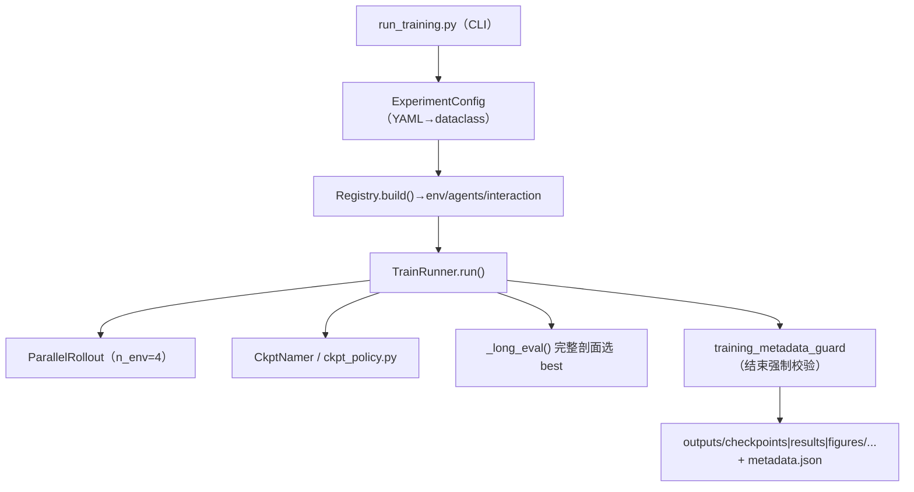

# RL 训练评估框架 Knowledge Base

## §0 Contents

| § | Title | When |
|---|------|------|
| §1 | 业务背景与核心概念 | 初次接触本领域 |
| §1.5 | 架构总览 | 快速建立分层调用模型 |
| §2 | 训练主流程与评估模式 | 改 trainer/跑实验前 |
| §2.5 | 物理路径速查 | 直接定位代码目录 |
| §3 | 代码入口索引 | 按改动场景找入口 |
| §4 | 配置体系索引 | 改 YAML/加实验前 |
| §5 | 评估与生图链路索引 | 出结果/画图前 |
| §6 | 核心规则与隐藏约束 | 改码/跑实验前必扫 |
| §7 | 验证路径 | 改动后如何验证 |
| §8 | 相关文档 | 跨领域阅读 |
| §9 | 覆盖与待填 | 文档置信度与缺口 |

## §1 业务背景与核心概念

统一训练框架：所有合法训练结论必须出自 `run_training.py`（`training_metadata_guard` 强制权威 metadata）或 legacy 入口 `train_fleet` / `train_cyclic_braking`（`save_metadata`+assert）。主线算法 **MAPPO**（`mappo_fleet`），DQN / CoorDQN 为辅助/历史线。

核心概念：
- **ExperimentConfig**（config_schema.py）：实验配置数据模型（算法/环境/交互/n_env/long_eval/warm_start/ckpt 策略/输出目录）。
- **Registry**：按 `env_type`/`algorithm`/`interaction` 统一构建 env、agents、交互逻辑。
- **ParallelRollout**：`n_env` 进程级并行（轨迹固定映射到 worker），主配置 `n_env: 4`。
- **long_eval**：`long_eval_interval > 0` 时 best 由周期性完整剖面评估选出（训练窗口 reward 不直接写 best）。
- **BC 热启动**（warm_start）：主配置开启。
- **权威 metadata**：`build_metadata()/save_metadata()/training_metadata_guard()`（metadata.py）。

## §1.5 架构总览



## §2 训练主流程与评估模式

`TrainRunner.run()`（train_runner.py）：建输出目录 → seed/device/OMP → 解析 resume（`ResumePlan`，支持 `--resume latest`）→ `Registry.build()` → 并行 rollout 训练循环 → 周期 `long_eval` 选 best → 保存 checkpoint（`FleetCkptNamer`：`mappo_fleet_best_*` / `mappo_fleet_ep*`）→ 结束时 `training_metadata_guard` 校验 metadata 已落盘。

评估模式：训练内 `long_eval`（`TrainFleetEnv(eval_cfg)`，eval_mode=True，长时域、安全判据）；独立评估/对比走 `src/evaluation/` 脚本（§5）。

## §2.5 物理路径速查

| 目录/文件（相对仓库根） | 内容 | 关键符号 |
|------|------|--------|
| traffic_rl_project/run_training.py | 统一训练 CLI | argparse 入口 |
| traffic_rl_project/src/trainer/train_runner.py | 训练主循环 | TrainRunner |
| traffic_rl_project/src/trainer/train_fleet.py / train_cyclic_braking.py | legacy 入口 | save_metadata+assert |
| traffic_rl_project/src/trainer/specs/ | 实验规格 | fleet_spec.py, cyclic_spec.py |
| traffic_rl_project/src/trainer/registry.py | 构建注册表 | Registry.build() |
| traffic_rl_project/src/trainer/parallel_rollout.py | n_env 并行 | ParallelRollout.run_episode() |
| traffic_rl_project/src/trainer/ckpt_policy.py | checkpoint 命名策略 | FleetCkptNamer 等 |
| traffic_rl_project/src/trainer/resume.py | 恢复协议 | ResumePlan |
| traffic_rl_project/src/trainer/config_schema.py | 配置数据模型 | ExperimentConfig, CkptDirs |
| traffic_rl_project/src/trainer/interaction.py | 交互策略 | MappoFleetInteraction 等 |
| traffic_rl_project/src/metadata.py | 权威 metadata | build_metadata(), training_metadata_guard() |
| traffic_rl_project/src/algorithms/ | 算法 | mappo_agent.py（主线）, dqn_agent.py, coor_dqn_agent.py |
| traffic_rl_project/src/evaluation/ | 评估/对比/生图 ~20 脚本 | evaluate_decompose.py 等 |
| traffic_rl_project/scripts/ | 运维/校验脚本 | check_outputs_layout.py, orchestrate_seed_eval.sh |
| traffic_rl_project/configs/ | 配置 | experiments/formation_ed_ab_3train_1plus1.yaml（主） |

## §3 代码入口索引

| 场景 | 入口 | 符号/参数 | 说明 |
|---|---|---|---|
| 正式训练 | run_training.py | `--experiment <yaml> --seed N` | 唯一权威入口 |
| 快速迭代 | run_training.py | `--episodes N` | 覆盖 YAML 主值仅限调试 |
| 恢复训练 | run_training.py | `--resume latest` | ResumePlan 协议 |
| 加新实验 | configs/experiments/*.yaml | 仿 formation_ed_ab_3train_1plus1.yaml | 键路径须与结构匹配 |
| 加新算法 | algorithms/ + registry.py | 仿 MAPPOAgent 注册 | networks/ 提供网络 |
| 改并行 | parallel_rollout.py | `ParallelRollout` | n_env 固定映射 |
| 改 ckpt 策略 | ckpt_policy.py | `CkptNamer` 子类 | 命名语义化 |
| outputs 布局校验 | scripts/check_outputs_layout.py | 一级分类 7 类 | 违规散文件/未知目录报警 |

## §4 配置体系索引

| 文件 | 角色 | 说明 |
|---|---|---|
| configs/experiments/formation_ed_ab_3train_1plus1.yaml | 主训练配置 | mappo_fleet / 1400 ep / n_env 4 / warm_start / long_eval_interval 50（ADR-017） |
| configs/experiments/decompose_loco_ed_ab.yaml | 机车级 ED/AB 实验 | |
| configs/experiments/dqn_cyclic.yaml, l1_cyclic_mappo.yaml, fair_dqn.yaml, platoon_mappo.yaml | 辅助/历史线 | |
| configs/experiments/_debug_*.yaml | 调试切片 | 勿当正式产物 |
| configs/env_config.yaml, train_config.yaml | 基础配置 | |

已知坑：YAML `.get()` 路径须与结构严格匹配，否则**静默回退默认值**；YAML 禁科学计数法（写 `0.0003`）。

## §5 评估与生图链路索引

| 用途 | 入口 | 说明 |
|---|---|---|
| 主评估（含 MPC 对比行） | evaluation/evaluate_decompose.py | `--mpc_type nmpc` 唯一合法；`--mode all` 全模式；`--n_seed` 多回合 |
| 分解评估 | evaluation/evaluate_decompose.py | decompose 通道 |
| 学习曲线 | evaluation/plot_learning_curve.py | |
| 物理曲线/轨迹 | evaluation/plot_physical_curves.py, plot_eval_traj.py（scripts/）, dump_eval_traj.py | |
| 汇总图 | evaluation/make_figures.py, make_5col_summary_fig.py | |
| 种子评估编排 | scripts/orchestrate_seed_eval.sh | |

生图铁律（详见 `docs/rules/EXECUTION_RULES.md`）：数据与绘图分离，图落 `outputs/sim_validation/figures/<主题>/`（可覆盖），原始数据落 `outputs/sim_validation/phys_validation/<语义前缀_时间戳>/`（不覆盖）；图内文字一律英文。

## §6 核心规则与隐藏约束

- **AI pitfall**【权威入口】不进 `run_training.py`（guard）或 legacy 入口（save_metadata+assert）路径的结论**不认可、不得引用**。
- **AI pitfall**【三输出目录】调试/冒烟必须同时重定向 `--checkpoint_dir`、`--results_dir`、`--override dirs.figures_dir=...`，否则覆写历史产物（LRN-20261001-009）。
- 【YAML 坑】`.get()` 键路径不匹配 → 静默回退默认值（无报错）；改结构必须全文核对取值路径。
- 【best 语义】`long_eval_interval > 0` 时训练窗口 reward 不写 best，best 只认完整剖面评估。
- 【outputs 规范】按产物类型 7 个一级分类（checkpoints/results/figures/logs/sim_validation/smoke/deprecated），运行目录 `语义前缀_时间戳`，禁止脚本往 `outputs/` 根级或任意 cwd 落盘。
- 【resume】`--resume latest` 走 `ResumePlan`；checkpoint 有协议测试锁定，改保存格式须同步 test_checkpoint_protocol.py。
- 【并行语义】`n_env` 是进程池并行（轨迹固定映射），不是向量化 env。

## §7 验证路径

```sh
cd /mnt/d/Code/MultiAgent/traffic_rl_project
python -m pytest tests/test_checkpoint_protocol.py tests/test_resume.py tests/test_mappo_train.py -q
python -m pytest tests/test_logging_metrics.py tests/test_metric_accounting.py tests/test_outputs_layout.py -q

# 冒烟训练（三目录重定向，勿改 YAML 主值）
python run_training.py --experiment configs/experiments/formation_ed_ab_3train_1plus1.yaml --seed 0 --episodes 2 \
  --checkpoint_dir outputs/smoke/_run/ckpt --results_dir outputs/smoke/_run/results --override dirs.figures_dir=outputs/smoke/_run/figures
```

## §8 相关文档

- `docs/rules/EXECUTION_RULES.md`：训练/评估留痕、产物目录、生图规范 SSOT
- `docs/REPRODUCIBILITY.md`：复现命令与机时实测（≈11.7 天/seed）
- `docs/PROJECT_PIPELINE.md`：总览 + 工作计划（执行流水见 `docs/logs/progress/PROGRESS_YYYY-MM.md`）
- `TRAIN_ENV_SAFETY_KNOWLEDGE_BASE.md`：被训练的环境
- `MPC_BASELINE_KNOWLEDGE_BASE.md`：对比基线
- `docs/logs/learnings/LEARNINGS.md`：LRN-20261001-009 等踩坑

## §9 覆盖与待填

- 代码推断覆盖：主流程/配置/评估链路已核对符号（2026-10-08）。
- 待填：evaluation/ 约 20 脚本未逐一展开（只列主入口）；specs 注册机制细节以代码为准。
- 用户经验输入：本次未做 Intake 问答。

<!-- Generated by doc-init on 2026-10-08; positioning: AI 跑训练/改 trainer/改配置前的速查 -->
