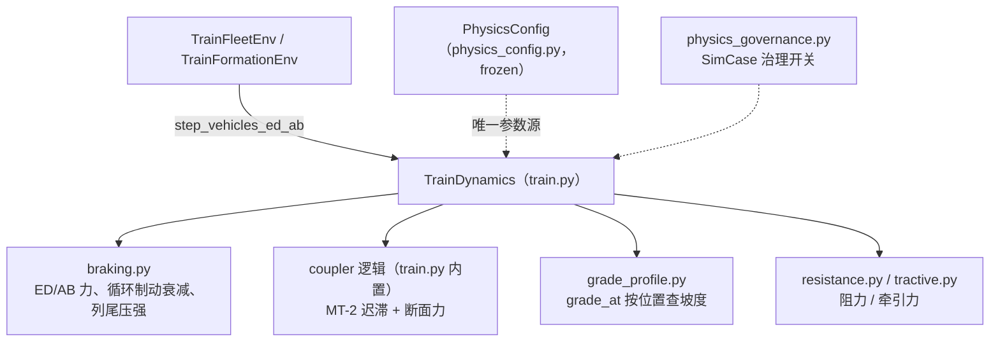

# 列车动力学仿真引擎 Knowledge Base

## §0 Contents

| § | Title | When |
|---|------|------|
| §1 | 业务背景与核心概念 | 初次接触本领域 |
| §1.5 | 架构总览 | 快速建立分层调用模型 |
| §2 | 核心仿真流程与状态 | 每步积分如何跑 |
| §2.5 | 物理路径速查 | 直接定位代码目录 |
| §3 | 代码入口索引 | 按改动场景找入口 |
| §4 | 关键参数与字段索引 | 改物理参数/编组前 |
| §5 | 治理开关与组件索引 | 改物理治理/开关前 |
| §6 | 核心规则与隐藏约束 | 改码前必扫 |
| §7 | 验证路径 | 改动后如何验证 |
| §8 | 相关文档 | 跨领域阅读 |
| §9 | 覆盖与待填 | 文档置信度与缺口 |

## §1 业务背景与核心概念

万吨级 1+1 重载列车（1 机车 + ~100 节货车）纵向动力学仿真，服务长大下坡（朔黄线 49.6km）循环制动场景的 MARL 研究。物理模型是训练/评估/对比基线的共同底座——**两侧物理同源**是铁律。

核心概念（正文规范术语）：
- **ED（电制动）**：连续量；**AB（空气制动）**：离散档位（`AirBrakeNotch`：RELEASE/MIN/SERVICE/EMERGENCY），沿制动波速传播。
- **车钩断面力**：相邻车厢间单钩受力，指标口径 SSOT = `TrainDynamics.coupler_interface_forces()`（ADR-018）；安全线 1000 kN。
- **MT-2 车钩**：唯一车钩模型（ADR-011），含间隙、迟滞、Stribeck 摩擦、刚性限位。
- **循环制动**：长大下坡充风-制动循环；段间衰减是基线物理（`enable_cyclic_degrade=True`）。
- **坡度剖面**：`GradeProfile.grade_at()` 按位置查询无量纲坡度；主剖面 `shuozhou_ningwuxi_beidaniu_49km`。
- **"多体"** = 集中质量（lumped）多体（ADR-022），非离散有限元。

## §1.5 架构总览



## §2 核心仿真流程与状态

每个仿真步（`dt=0.1s`）：
1. 环境给每台机车 `[ED, AB]` 动作 → `TrainDynamics.step_vehicles_ed_ab()`；
2. AB 连续减压量经 `notch_from_throttle()` 映射为离散档位；制动力由 `air_brake_force_real()`（β_c 牵规法）或 `air_brake_force_by_reduction()` 计算，沿波速传播生效；
3. 循环制动段间衰减 `cyclic_braking_degrade()`（赵紫宁表 5-5）与列尾压强梯度 `cylinder_pressure_gradient()` 作用；
4. 各车受牵引/制动/坡度/阻力合力，经车钩（MT-2 迟滞，`_coupler_interface_forces_vec()` 向量化）传递，积分更新；
5. 断面力经 `coupler_interface_forces()` / `coupler_interface_forces_per_vehicle()` 输出（安全层与评估口径不同，见 §6）。

状态机：AB 档位 `AirBrakeNotch`（RELEASE→MIN→SERVICE→EMERGENCY）；ETCS 曲线（`EtcsBrakingCurve`）恒启作 ATP 底线（无开关）。

## §2.5 物理路径速查

| 目录/文件（相对仓库根） | 内容 | 关键符号 |
|------|------|--------|
| traffic_rl_project/src/train_dynamics/ | 动力学引擎 9 文件 | TrainDynamics, GradeProfile |
| traffic_rl_project/src/train_dynamics/train.py | 主引擎 + 车钩 | TrainDynamics, step_vehicles_ed_ab(), coupler_interface_forces() |
| traffic_rl_project/src/train_dynamics/braking.py | 制动力/档位/衰减 | air_brake_force_real(), cyclic_braking_degrade() |
| traffic_rl_project/src/train_dynamics/params.py | 编组与参数 | VehicleParams, CouplerParams, TrainConsist |
| traffic_rl_project/src/train_dynamics/grade_profile.py | 坡度/限速剖面 | GradeProfile.grade_at(), SpeedLimitProfile |
| traffic_rl_project/src/train_dynamics/etcs_braking.py | ETCS 制动曲线 | EtcsBrakingCurve |
| traffic_rl_project/src/train_dynamics/rigid_multi_particle.py | 刚性多质点简化模型 | RigidTrain |
| traffic_rl_project/src/physics_config.py | 唯一物理配置 | PhysicsConfig（frozen dataclass） |
| traffic_rl_project/src/physics_governance.py | 仿真工况治理开关 | SimCase |
| traffic_rl_project/tests/ | 物理不变量与基准测试 | test_train_dynamics.py 等 |

## §3 代码入口索引

| 场景 | 入口 | 符号 | 说明 |
|---|---|---|---|
| 改每步积分/力平衡 | train.py | `TrainDynamics.step_vehicles_ed_ab()` | 环境层唯一调用入口 |
| 改车钩模型 | train.py | `_coupler_interface_forces_vec()` | MT-2 迟滞向量化实现 |
| 取车钩力指标 | train.py | `coupler_interface_forces()` | 断面力 SSOT（ADR-018） |
| 改 AB 档位/制动力 | braking.py | `air_brake_force_real()`, `notch_from_throttle()` | 牵规法 β_c |
| 改循环制动衰减 | braking.py | `cyclic_braking_degrade()` | 段间衰减乘子 |
| 改坡度剖面 | grade_profile.py | `GradeProfile.grade_at()` | MPC 亦逐线重喂同一接口 |
| 改物理参数 | physics_config.py | `PhysicsConfig` | frozen；只此一处 |
| 简化刚性模型验证 | rigid_multi_particle.py | `RigidTrain.step()` | 非主链 |

## §4 关键参数与字段索引（PhysicsConfig / 编组参数）

| 字段 | 类型/默认 | 业务含义 | 改动注意 |
|---|---|---|---|
| v_max_mps | 80/3.6 | 朔黄线限速 80 km/h | 改线路需同步坡度剖面 |
| v_min_mps | 40/3.6 | 最小缓解速度 | 安全层判断依据 |
| dt | 0.1 | 积分步长 | 改动破坏与历史结果可比性 |
| target_speed_mps | 20.0 | 巡航参考速度（限速带中值） | 编队速度带中心 |
| target_gap_m | 100.0 | 目标列距 | 编队间距项 |
| consist_preset | '10kt_1plus0' | 论文编组 | 多列 1+1 时在此改 |
| grade_profile | 'shuozhou_ningwuxi_beidaniu_49km' | 主训练剖面 | history 'shuozhou_23800' 仅 Zhang2024 复现 |
| coupler_force_limit_n | 1.0e6 | 1000 kN 底线 | 不可逾越（主轴铁律） |
| enable_cyclic_degrade | True | 循环制动段间衰减 | 关掉 = 非基线物理（R0-D） |

编组侧：`params.py` 的 `VehicleParams/LocomotiveParams`（机车 vs 货车动力学参数）、`CouplerParams`（MT-2 刚度/间隙/摩擦）、`TrainConsist`（编组装配）。

## §5 治理开关与组件索引

| 类型 | 符号 | 位置 | 何时生效 |
|---|---|---|---|
| 工况治理 | `SimCase` | physics_governance.py | 区分正式/复现工况，防物理混用 |
| ATP/ETCS | `EtcsBrakingCurve` | etcs_braking.py | 恒启，无开关（安全底线） |
| 衰减开关 | `enable_cyclic_degrade` | physics_config.py | 基线物理开关 |

## §6 核心规则与隐藏约束

- **AI pitfall**【禁手写常量】一切物理值从 `PhysicsConfig` 取（模块 docstring 明言）；脚本里写 `80/3.6` 等字面量 → 训练/验证动力学不同源。
- 【口径】车钩力指标 SSOT = `coupler_interface_forces()`（断面力，ADR-018）；`_coupler_forces()`（每车合力）与 `coupler_interface_forces_per_vehicle()` 用途不同，勿混用于安全叙事。
- 【禁改】车钩模型统一 MT-2（ADR-011），QKX100 已移除，勿重新引入。
- 【隐式】`enable_cyclic_degrade=True` 是基线物理；ATP/ETCS 恒启无开关——改这两处 = 改基线，须走 ADR。
- 【命名】"多体" = 集中质量（lumped）多体（ADR-022）；`rigid_multi_particle.py` 是简化验证模型，非主链。
- 【低置信】波速传播/接触渐入等引擎内部细节的完整清单在 `docs/VALIDATION_BASELINE.md` 附录 A/B（设计 SSOT），本 KB 不复制。
- 【铁律】训练/评估/对比基线必须共用同一物理模型；禁止一边改物理一边做对比。

## §7 验证路径

```sh
cd /mnt/d/Code/MultiAgent/traffic_rl_project
python -m pytest tests/test_train_dynamics.py tests/test_braking_propagation.py tests/test_coupler_model_refined.py tests/test_coupler_gap.py tests/test_grade_profile.py -q
python -m pytest tests/test_physical_invariants.py tests/test_physics_governance.py tests/test_etcs_braking.py -q
# 改车钩/制动触及物理基准时：
python -m pytest tests/test_field_benchmarks.py -q
```

## §8 相关文档

- `docs/VALIDATION_BASELINE.md`：设计明细 + 引擎 Gotchas 附录 A/B（物理设计 SSOT，先读它）
- `docs/logs/decisions/DECISIONS.md`：ADR-011（MT-2）/ ADR-018（断面力）/ ADR-022（lumped 术语）
- `TRAIN_ENV_SAFETY_KNOWLEDGE_BASE.md`：动力学如何被环境调用
- `MPC_BASELINE_KNOWLEDGE_BASE.md`：NMPC 共用本引擎物理

## §9 覆盖与待填

- 代码推断覆盖：入口/参数/开关均已核对代码符号（2026-10-08）。
- 待填：引擎内部数值细节（波速、迟滞参数表）未在本 KB 展开——以附录 A/B 为准；如附录与代码冲突，以代码为准并回写诊断日志。
- 用户经验输入：本次未做 Intake 问答。

<!-- Generated by doc-init on 2026-10-08; positioning: AI 改动力学/车钩/制动/坡度代码前的速查 -->
