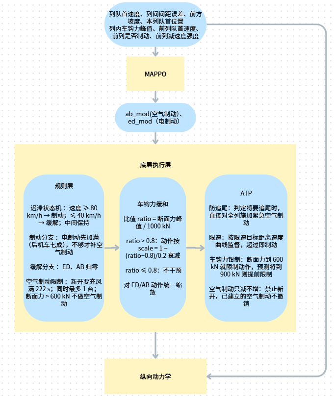
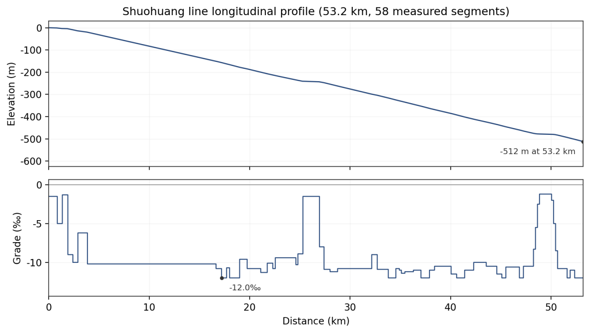
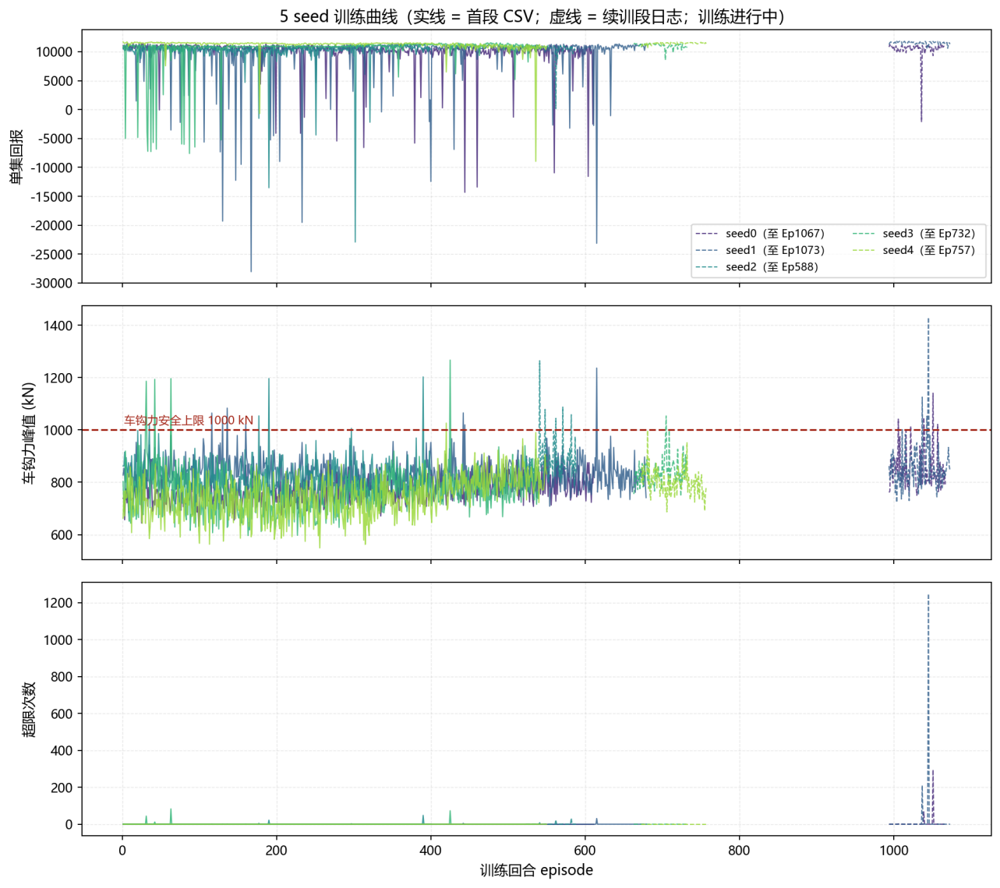
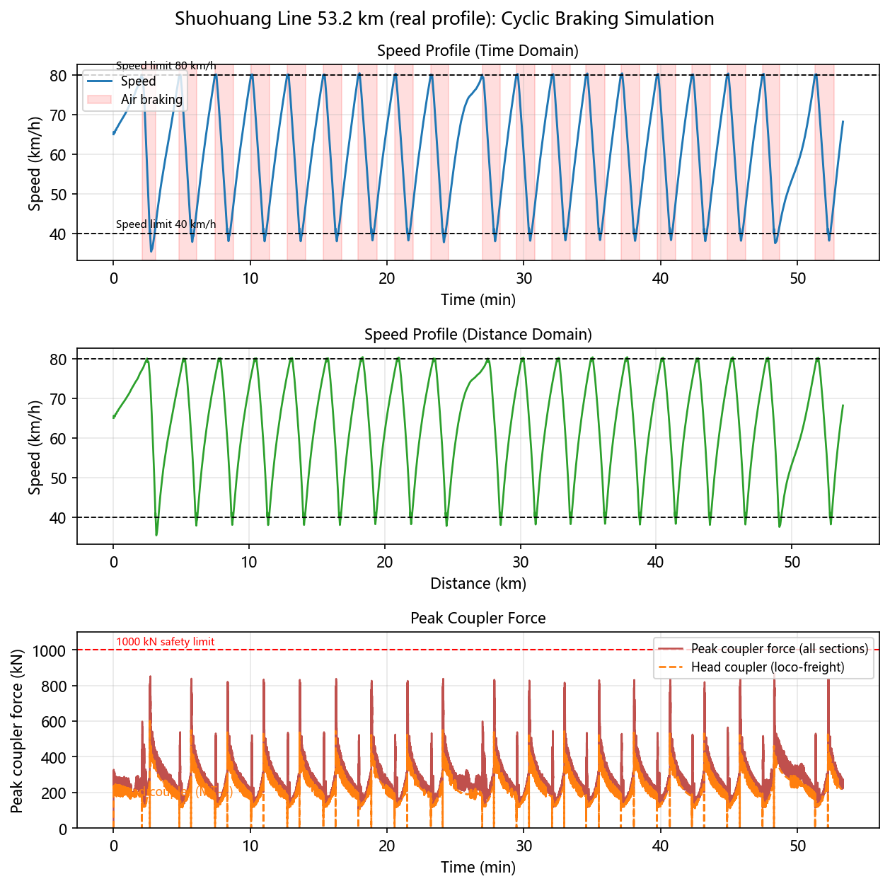
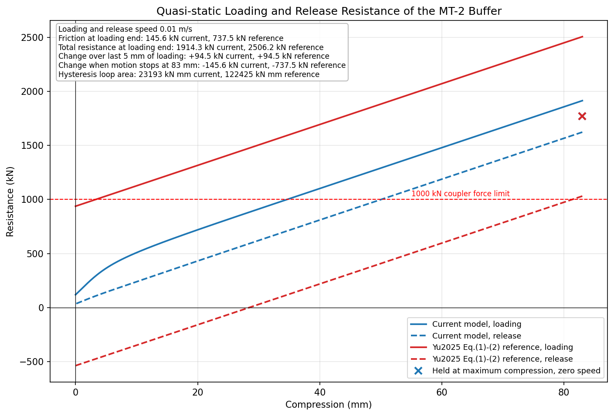
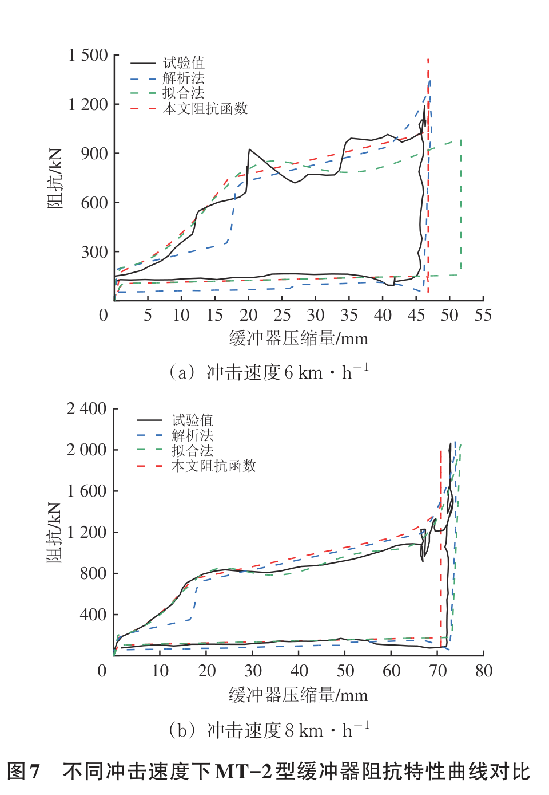

# 项目情况（2026-10-17 更新）

> 本文档由 2026-10-16 版《项目介绍和问题简述.docx》提取，并按项目现状更新（研究对象、立论、实验矩阵以 2026-10-13~16 的最新决策为准）。

## 一、项目介绍

论文题目暂定《面向长大下坡场景基于多智能体强化学习的重载列车群组自动控制方法》。研究对象是**二万吨级 1+1 重载列车**：每列 = 头部机车 + 216 节货车 + 中部机车（约 2.2 万吨，对齐朔黄线 2016 年起常态化运营的 2 万吨「1+1」组合列车，编组与张二田实车、Zhang2024 文献逐位一致）；三列组成群组 = 6 台机车智能体，一起通过长大下坡。注意「1+1」双义：单列内部指朔黄实际运营组合列车（头+中部机车），列间指虚拟耦合群组（编队对象）。

核心观点（2026-10-19 ADR-042 更新）：**相对传统基线的编队指标收益**——formation-aware 机车级多智能体强化学习（本文方法，简称 D-RL），相比文献规则基线（简称 D-Rule）与 Tube MPC（按 Song2026 架构复现、无车钩力建模），显著改善列距保持与列间速度差（收敛）；本文方法车钩力 ≤1000 kN 由安全防护架构保证，不作对比胜出主张。达标口径参考 Hu2026：列距误差 ±5%、速度误差 ±2%。**独立消融（各列独立决策对照）已废除（ADR-042）**：真实运营中不存在三列各自独立运行的工况（虚拟编组的业务前提就是协同运行），独立组不是真实可对照的运行模式，且增益分解命题偏离工程命题。更早的旧核心论点「零微调达到 MPC 水平 / 免重辨识成本」已废止（ADR-032）：坡度图纸天然先于线路运营存在，MPC 本无"缺坡度数据"问题，成本叙事也不构成学术贡献。

导师最初给定的方向：

长大下坡，列车编队，万吨级列车，车钩力1000kN以下，安全高效

（2026-10-14 档位化修订：车钩力按工况分档——正常运行 ≤1000 kN 目标 / 制动工况验收 ≤1500 kN / 安全硬顶 2250 kN；依据 = 靳新元2018 朔黄 2 万吨动态试验 + 张二田/王鼎实车数据。1000 不再是全工况硬顶。）

后续修正：

需要找到针对MPC（传统方法）的局限MARL的改进，而不是全面超越MPC

实验矩阵（2026-10-19 最终版，ADR-042）的设计逻辑：核心观点是"相对传统基线的编队指标收益"，所以主对比在同一仿真器、同一坡度数据上直接对比规则基线与 Tube MPC，且主对比场景**物理关闭车钩力**（Tube MPC 无车钩力建模，关掉后三方同物理、只比编队指标才公允），车钩力红线由本文方法的安全防护架构单独保证、不作对比胜出主张；导师要求"找 MARL 相对 MPC 的改进而非全面超越"，MPC 对比限定同一仿真器、同一坡度数据、同档调参力度；**不设独立消融组**（ADR-042：真实运营无此运行工况）；NMPC 因方法与场景不匹配、忠实复现不成立而退出主表，只在相关工作交代。

| 组别 | 场景 | 方法 | 说明 |
|---|---|---|---|
| 主对比 | 同一仿真器、同一环境与坡度数据（朔黄 49.6 km 宁武西→北大牛真实坡度剖面），**物理关闭车钩力** | 规则基线 D-Rule / Tube MPC（Song2026 架构、无车钩力建模）/ 本文方法 D-RL | 只比编队指标（列距/列间速度差），不比车钩 |
| 跨线泛化 | 训 49.6 km → 测 35 km（域外真实剖面） | 本文方法 D-RL（严格零微调） | 泛化性能保持（2026-10-19 由储备升为正式组别） |

评价指标（2026-10-19 ADR-042 更新；5 个随机种子取显著性）：主对比场景物理关闭车钩力，评**列距误差、列间速度差**；安全底线作达成记录（不作对比胜出主张）：车钩力断面力峰值与超限步数（本文方法单独验证）、ATP（列车超速防护）触发次数、旅行时间/能耗不劣化。

对比纪律：NMPC（非线性 MPC）退出主对比表，只进相关工作（其方法与本文场景不匹配，忠实复现不成立）；**不设独立消融组**（ADR-042：真实运营无三列各自独立运行的工况）；明确不做三类设置——关闭安全层的消融、换成其他 MARL 算法、单智能体参照行，均留作审稿修改预案。

实验现状

已完成：

- 仿真器 + 训练环境 + 安全层建成，并用文献实测数据校验过（MT-2 缓冲器 83 mm 行程下 2270 kN 峰值吻合；装载/缓释曲线失真问题已按学姐推荐的容嘉欣2025 查表 + 速度法修复，全部测试通过）
- 架构定型（图 1）：强化学习定策略（每台机车一个智能体，电制动连续调节与空气制动离散档位分工）→ 底层由规则循环制动、车钩力安全层、ATP 确定性执行
- 主训练配置就位：49.6 km 真实剖面，3 列 × 1+1 = 6 个机车智能体，训练预算 1400 回合、4 进程并行采集、行为克隆热启动
- 车钩力超限的根因已定位并修复：空气制动波传播滞后，超出安全层"感知即限幅"能覆盖的范围；且训练窗 120 秒短于空气制动充风时滞 222 秒。补齐安全层时序闸门后，车钩力峰值 1112→990 kN 达标。另：历史训练还暴露过间歇性策略坍塌与探索熵持续上升导致的失控，将在延长训练窗后的重训中重点观察
- 规则基线 D-Rule 按 2 万吨口径完成多轮标定：当前最佳组态车钩力峰值 1815.6 kN / 均速 63.44 km/h / 超限 339 步 / 全程最低速度 44.2 km/h；距 1350 kN 验收线（1500 留 10% 余量）尚差 466 kN，可调参数已系统扫描完毕
- 底层控制器平稳性专项修复（针对图 4 导师指出的问题）：分级制动「浅档起步、深超速兜底」、制动档位过渡平滑、电/空制动切换阈值等修复，纵向冲击下降；整线验收仍在迭代
- MPC 基线管道已跑通：非线性 MPC + 规则层在全程剖面稳定运行（车钩力峰值 967 kN、0 超限）
- 训练提速：进程级并行落地（串行约 3.5 天/seed → 并行约 1.5 天/seed 量级）；训练起始位置随机化已验证（2 个随机种子的长剖面评估全部达标）

未完成：

- 正式主训练（1400 回合 × 5 随机种子）未跑：重启方案已定（训练窗延长至 250 秒等修正；旧一万吨编组的训练成果已全部作废）。主对比实验等主训练完成后开跑

图 1：系统架构（强化学习定策略 + 底层规则/安全层执行）

图 2：训练与评估线路（朔黄线宁武西→北大牛 49.6 km 真实坡度剖面）

图 3：训练学习曲线（历史试点，二万吨重训后更新）

图 4：底层控制器制动策略（导师指出速度波动太大——已立案专项修复，整线验收迭代中）

## 二、给学长的问题（按现状更新）

1. 怎么读论文

我现在的目标是每篇文章能用五个问题读完：a. 目前的工作有什么意义，背景上有哪些难点；b. 针对这些难点，别人做了什么；c. 有什么不足；d. 我们针对不足做了什么改进；e. 取得了什么效果。想请教：这五个问题分别该去论文的哪个部分找、怎么判断找得对不对；关键词怎么搜（英文中文）；时间有限的时候，方法和实验哪部分值得精读、哪部分可以略读。

2. MARL 训练稳定性（重点想请教）

已定位的训练障碍：训练窗 120 秒短于空气制动充风时滞 222 秒（奖励要在窗口外才能体现），已把训练窗延长到 250 秒；此外历史训练出现过间歇性策略坍塌、探索熵持续上升导致的失控。想请教：a. 这种"物理时滞长于决策窗、奖励延迟到窗口外"的问题，除了拉长窗口还有什么成熟做法（奖励塑形 / 分段信用分配 / 课程学习）；b. 熵系数、学习率、KL 早停这类超参在多智能体 PPO（我们的规模是 3 列 6 智能体）上的调参经验；c. 正式对比用 5 个随机种子够不够，显著性检验建议怎么做（我们是同一环境下的成对对比）。

3. 对比设计的合理性（2026-10-19 更新：独立消融已废除——真实运营无三列各自独立运行的工况，原"屏蔽方式怎么选"一问随之失效）

核心论点改为"相对传统基线的编队指标收益"（ADR-042）：主对比场景物理关闭车钩力，本文方法对比规则基线与 Tube MPC（按 Song2026 架构复现、无车钩力建模），评列距与列间速度差。想请教：与编队 MPC 基线对比要求"同档调参力度"，操作上怎么界定和报告才公允。

4. 物理仿真器（✅ 已解决）

上次请教的车钩 MT-2（缓冲器型号）装载/缓释曲线失真问题已定位实锤：低速段摩擦被方向平滑项抹掉（加载末段摩擦分量 145.6 vs 文献 737.5 kN），迟滞环耗能只有文献的 1/5。车钩缓冲器模型整体复刻自容嘉欣等（2025），修复也按其图 4(b) 数字化查表 + 速度法实现（2026-10-12 落地），复现对照：迟滞环面积 61894 vs 文献 62091 kN·mm（1.00 倍），全部测试通过。

> 所复刻论文：容嘉欣, 凌亮, 姚小沛, 等. 更大牵引质量重载列车动力学建模与仿真分析[J]. 机械, 2025, 52(7): 57-64.

还想继续请教：物理仿真层还有哪些值得主动对标实测数据验证的环节？

图 5：修复前我们模型的装载/缓释曲线与文献对照（问题证据）

图 6：文献里的装载/缓释曲线（于宗泽等, 中国铁道科学, 2025, 46(2). DOI: 10.3969/j.issn.1001-4632.2025.02.17. 图 7，不同冲击速度下 MT-2 阻抗特性，含试验实测）

5. 如何分工（已落定，想请学长把关）

三人已按模块划界（2026-10-12）：车钩力/安全层/单车侧、编队上下文/消融侧、底层控制器侧；每个模块只有一个负责人，共享文件的改动先登记再改；约定主训练启动前，各模块在同一代码版本上测试全部通过。想请教：这个分工方式有什么坑，对齐进度用什么方式最省事。

6. 算力问题（部分解决）

训练提速已落地进程级并行（串行约 3.5 天/seed → 并行约 1.5 天/seed 量级），但 5 个随机种子的正式训练 + 对比基线（规则基线、Tube MPC）的机时仍然紧张。想问：a. 你平时训练都在什么设备上跑（显卡型号 / 并行规模大概什么水平）；b. 实验室的服务器情况怎么样、是否可以申请使用？另外瓶颈仍在物理层仿真（单个物理步长 0.1 秒），目前没有找到长大下坡+重载列车编队+强化学习+车钩力的同款文献，不太清楚物理层要简化到什么程度，想听建议。

7. 方向（✅ 已解决）

上次问的"免重辨识成本要不要砍掉"已定：砍掉。证据核查发现其前提不成立（坡度图纸天然先于线路运营存在，MPC 无"缺坡度数据"问题），且成本叙事不构成学术贡献。当时改押"编队上下文协同增益"（2026-10-19 注：该 claim 已由"相对传统基线的编队指标收益"接替，独立消融废除，见第一节实验矩阵，ADR-042）；MPC 对比口径改为同一仿真器、同一环境与坡度数据、同档调参力度；跨线零微调已由储备升为正式组别（ADR-042）。

8. 会议（2026-10-17 检索汇总）

> **【已冻结（2026-10-21）】**：会议截稿时间的 SSOT 已迁至 [`docs/TARGET_CONFERENCE.md`](../TARGET_CONFERENCE.md)。本节保留 2026-10-17 向学长咨询时的原文，**不再更新**；其中 ICARA 2027 截稿 10-01（实为 11-10）、RPIC 属 12 月截稿等说法已在 TARGET_CONFERENCE 中按官网更正。

想投 **2027-06-30 前 EI 可检索**的会议；理想截稿 12 月前后、英文。经三轮检索核实（对口档 + 泛主题档，截稿均查官网一手），可投候选如下：

**候选会议（截稿未过）**

| 会议 | 截稿 | 会期 | 出版·检索 | 备注 | 可信度 |
|---|---|---|---|---|---|
| [ICARA 2027](https://icara.us)（第13届自动化·机器人与应用） | 11-10（与首页 10-01 冲突，**需邮件确认**） | 2027-02-25~27 巴黎 | IEEE Xplore + EI，2021–2026 六届连续 | **Track 2 = Multi-Agent Systems，最对口** | 官网一手 |
| [ICRCA 2027](http://icrca.org)（第11届机器人·控制与自动化） | 11-10（官网明确） | 2027-03-26~28 日本会津 | IEEE Xplore + EI，近 5 届连续 | 控制/自动化 | 官网一手 |
| [ICRAI 2026](http://icrai.org)（第12届机器人与 AI） | 11-05（缓存，待确认） | 2026-12-18~20 韩国仁川 | 2025 届 IEEE Xplore，历年全 EI | Multi-Robot Systems track | 官网一手（日期冲突） |
| [RAAI 2026](http://raai.net)（第6届机器人·自动化与 AI） | 11-01（待确认） | 2026-12-18~20 新加坡 | IEEE Xplore + EI 五届连续 | 智能控制系统 | 官网一手（日期冲突） |
| [ICIAI 2027](https://www.iciai.org)（AI 应用，泛主题） | **12-10** | 2027-04-26~29 曼谷 | Springer LNEE + EI/Scopus | 投"控制与自动化"方向；**唯一 12 月截稿的稳妥项** | 官网一手（163 邮箱） |
| [ICIEA 2027](https://www.iciea.org/date.html)（第14届工业工程与应用·曼谷，注意非 IEEE 同名会） | 11-25 | 2027-04-18~21 | Springer，往届 EI + Scopus | 自动化/控制 | 官网一手 |
| [IEEE ICMEE 2026](https://www.icmee.org/index.html)（机电·电子工程） | 11-30 | 2026-12-29~31 广州 | IEEE Xplore + EI（往届实绩） | "机电一体化与智能控制"沾边 | 需核 IEEE 编号 |
| [ICEEE 2027](http://www.iceee.org)（电气·电子工程） | 12-01（二手） | 2027-04-16~18 安卡拉 | IEEE Xplore + EI | Track 2 控制/自动化 | 官网未更新 2027 版 |
| [DSIE 2026](https://dsieconf.org/index.htm)（数据·智能工程） | 11-15（官网延期版） | 2026-12-05~06 深圳 | IOS FAIA，EI 承诺 | 泛智能工程 | 163 邮箱 |
| [AIRC 2027](https://www.airc.org)（AI 与机器人） | 11-20 | 2027-04-06~08 美国坦佩 | 二手称 IEEE + EI 未核验 | AI + 控制 session | outlook 邮箱 |
| ICAIES 2027 / ICRIC 2027（保底） | 11-10 / 11-05 | 2027-03 里约 / 2027-02 米兰 | 承诺 EI，**无往届实证** | 初届嫌疑，投前必查 IEEE 会议编号 | 低 |

**结论：最主推 ICARA 2027**——理由三点：① 方法论最对口（Track 2 = Multi-Agent Systems，直接征多智能体学习）；② 检索余量最大（2 月底会期，距 2027-06-30 检索红线时间最充裕）；③ 2021–2026 六届 IEEE Xplore + EI 归档实证。唯一悬点是 11-10 截稿轮需邮件确认；确认失败则以 ICIAI 2027 为主力（12-10 截稿，唯一能多买一个月写作时间的稳妥项），构成"ICARA 冲对口、ICIAI 兜时间"的双保险。

**特殊项（两条路）**

- [CMSDA 2026](https://icmsda.com)（第6届计算建模·仿真与数据分析，南昌 12-04~06）：IEEE 出版、往届 Xplore 实证、征稿主题明确含强化学习；但最新截稿轮 **10-19（仅剩 2 天，来不及成稿），只能等延期轮官宣**。高校主办，艾思科蓝运营（版面费约 3600 元）。
- [CCDC 2027](http://www.ccdc.neu.edu.cn/001/list.htm)（第39届中国控制与决策会议，长沙 2027-05-14~16）：截稿 10-31，**契合度与声誉最佳**；但官网实证往届 EI 在会后约 5 个月完成（CCDC 2026：5 月会期 → 10 月中 EI），预计 **2027-10 才可检索**，不达 6-30 硬约束——除非接受"录用证明先行、EI 稍后"。

**已排除（核实后出局）**

- RAIC / CITCE / MAIC 2026：截稿 9 月下旬已过（"12 月"是会期不是截稿）；ICCR 2026：官网 10-01、无延期佐证；ICIRT 2026（IEEE 铁路，最对口）：6-30 已过；MIC 2026：官网 10-26 截稿来不及、往届走 SPIE；AISRA 2026：官网 9-20 已过；ICITSC 2027：官网 404/模板假站；AMMER 2026：126 邮箱投稿、IEEE 查无编号，不推荐。

**行动建议**

1. 本周发邮件确认：ICARA 的 11-10 轮、ICRAI/RAAI 的 11 月延长轮真伪；同时盯 CMSDA 延期轮。
2. 主力方案双保险：**ICARA 2027（最对口）+ ICIAI 2027（12-10 截稿，多买一个月写作时间）**。
3. 与老师对齐两点：① 若 6-30 前必须 EI 可检，11 月窗口只剩 3-4 周成稿时间（主训练未完，需决定用受控基线/试点数据冲刺还是放宽截稿）；② 若可放宽，CCDC 2027 是学术上最好的选择（EI 约 2027-10）。
4. 投稿前一律在 conferences.ieee.org 查会议编号：凡免费邮箱投稿且查无编号者不投。

想问问学长：这几个里面有没有你了解底细、可以直接推荐的？
